<p align="center">
  
</p>

<p align="center">
  Web console and diagnostic workbench for AI coding agents.<br>
  <a href="https://github.com/can1357/oh-my-pi">Oh-My-Pi</a> (<code>omp</code>) by default, with Claude Code, Codex, OpenCode and any ACP agent beside it.<br>
  Watch, steer and audit autonomous coding sessions from one paper-flat dashboard.
</p>

<p align="center">
  <a href="https://www.npmjs.com/package/@kabmo-labs/kabmo"></a>
  <a href="https://bun.sh"></a>
  <a href="https://elysiajs.com"></a>
  <a href="https://preactjs.com"></a>
  <a href="https://shiki.style"></a>
  <a href="package.json"></a>
</p>

<p align="center">
  <a href="https://github.com/kabmo-labs/kabmo/wiki">Wiki</a> ·
  <a href="AGENTS.md">Architecture</a> ·
  <a href="DESIGN.md">Design</a> ·
  <a href="CHANGELOG.md">Changelog</a> ·
  <a href="docs/milestones/M04-plugin-platform.md">Plugins</a> ·
  <a href="https://github.com/kabmo-labs/kabmo/issues">Issues</a>
</p>

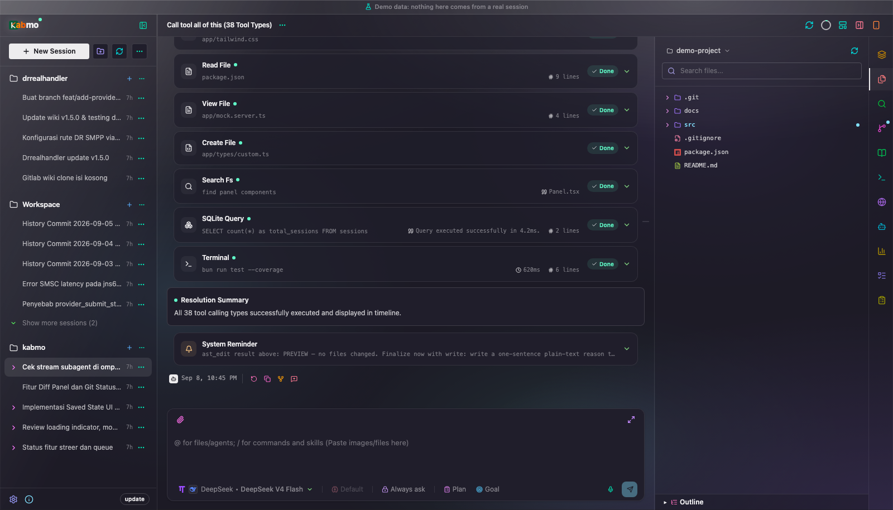

## What it is

The web app over a live agent install. It is not a terminal wrapper: Kabmo reads the agent's own
session data — omp's JSONL store, project registry, config and subagent transcripts, or an ACP
agent's own protocol — folds it into one live view, and writes back through the same channel.

```bash
kabmo serve                # production server + prebuilt client on :3000
bun run dev                # source checkout: one process, HMR, no build step
```

- **One process.** Elysia serves the API and the client bundle, and the agent event stream is a
  first-class WebSocket route on that same listener (SSE as fallback) — no second server, no proxy,
  no separate client watcher.
- **Many harnesses, one console.** `omp` over RPC is the default; fifteen ACP agents sit beside it
  — omp's own ACP surface, Claude Code, Codex, OpenCode, Command Code, deepseek-harness,
  Antigravity, MiniMax, pi, qwen, kimi, Cursor, ZCode, JCode and Grok — plus a user-added ACP
  agent. The composer's model dropdown picks the harness per chat; tabs, marks, capabilities and
  settings follow that choice.
- **Two data modes.** `MOCK=false` (the default, also when unset) runs on the real SQLite database
  and your real workspace; `MOCK=true` swaps in bundled demo datasets. Every screenshot and
  recording on this page was captured in `MOCK=true`, in the **glass** surface style with
  **full-colour** icons.
- **Bun only.** The server imports `bun:sqlite` and `Bun.YAML`, the client is bundled by `Bun.build`,
  and sessions, config and updates shell out to the agent's own CLI.

## Feature tour

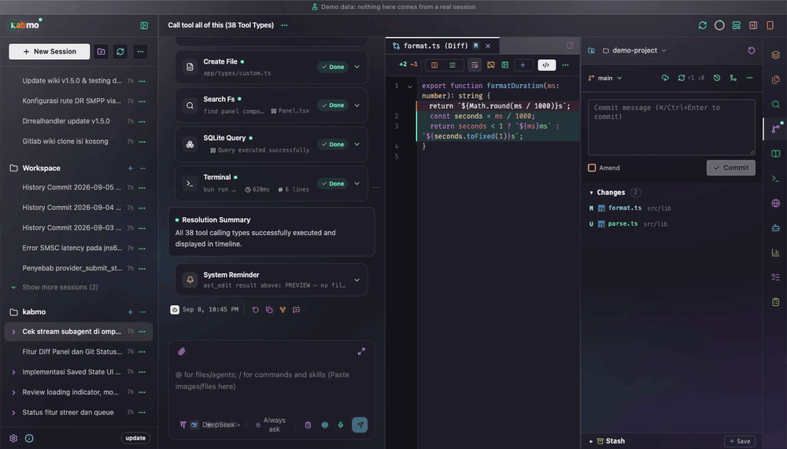

<sub>Full-quality recording (MP4, 23s): [docs/assets/tour.mp4](docs/assets/tour.mp4) · theme cycle in motion: [docs/assets/themes.gif](docs/assets/themes.gif)</sub>

| | |
|---|---|
| <br>**Files** — project tree with git markers, cut/copy/paste, drag-to-move, and a file open in the editor | 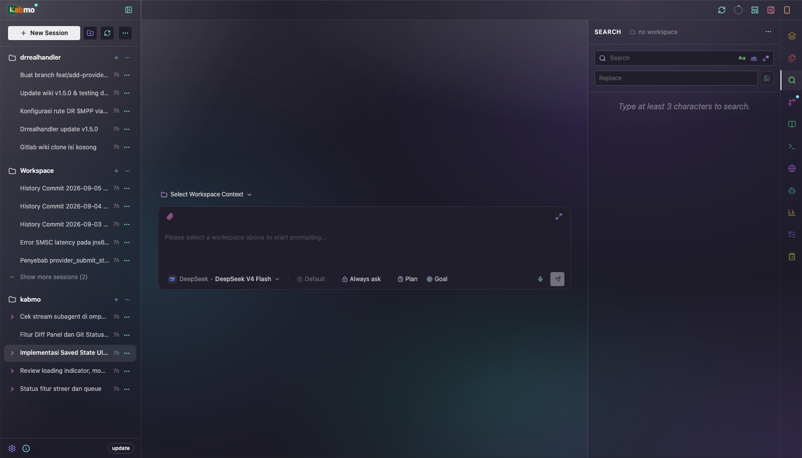<br>**Search** — ripgrep-backed streaming results, virtualized list, in-file jump and replace preview |
| 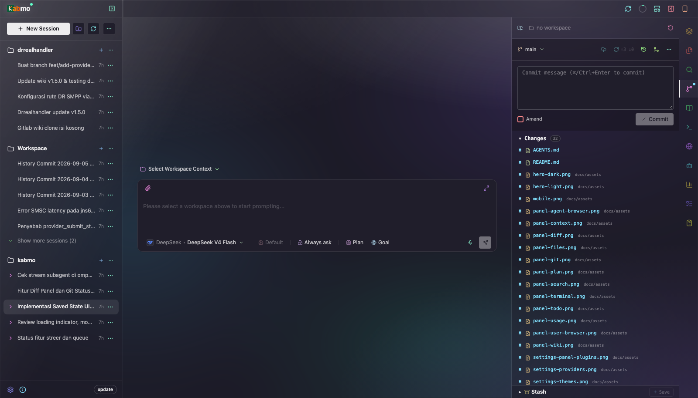<br>**Source Control** — changes, commits, branches, tracking, stash, and merge/rebase conflict resolution | <br>**Editor & diff** — split or unified, full-code or diff-only, word wrap, find/replace, command palette |
| 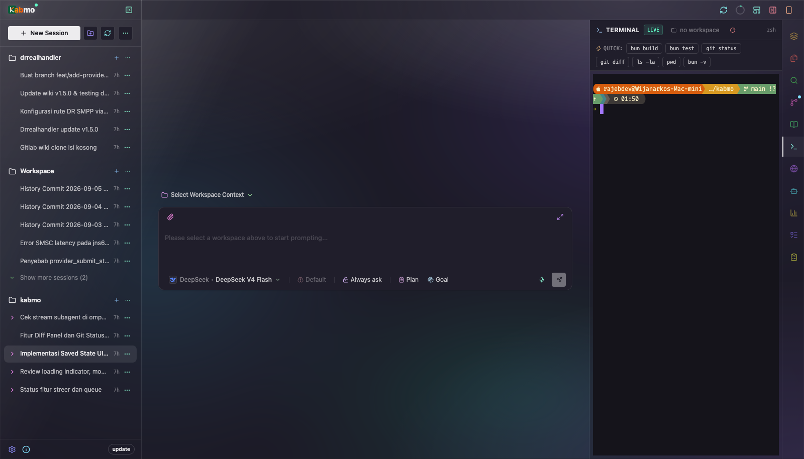<br>**Terminal** — a real PTY (one shell per terminal id, scrollback replayed on reload) | 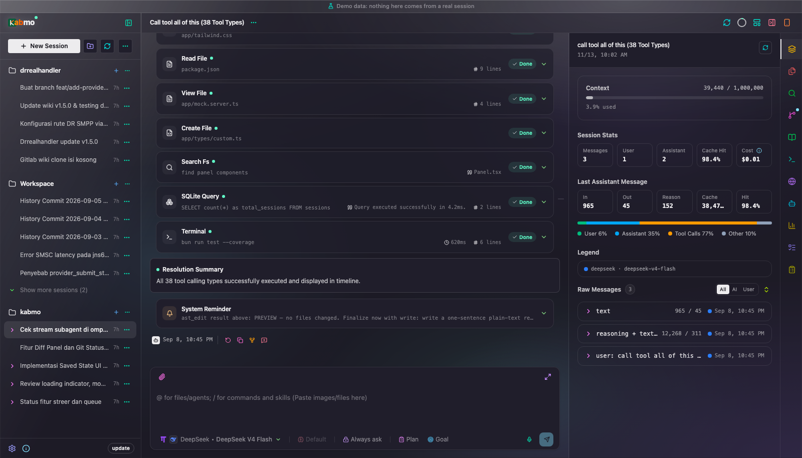<br>**Context & telemetry** — context window use, cache hit rate, cost, per-message breakdown |
| 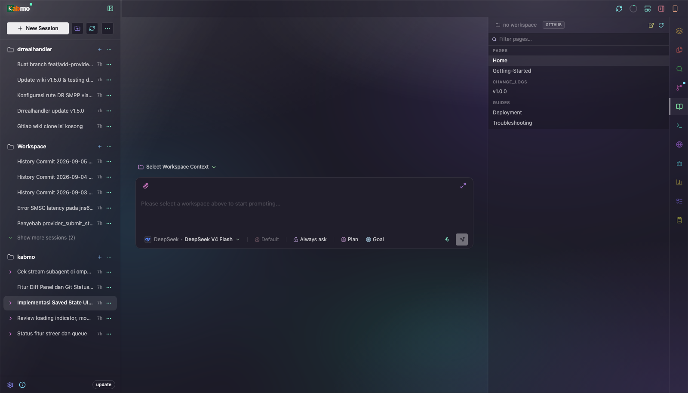<br>**Wiki** — reads a project's GitHub/GitLab wiki over git, with its own `_Sidebar` as navigation | 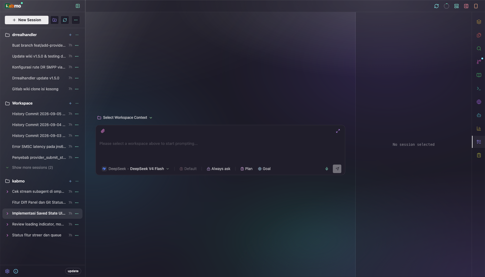<br>**Todos** — the session's live list, all five omp statuses, blockers and per-phase progress |
| 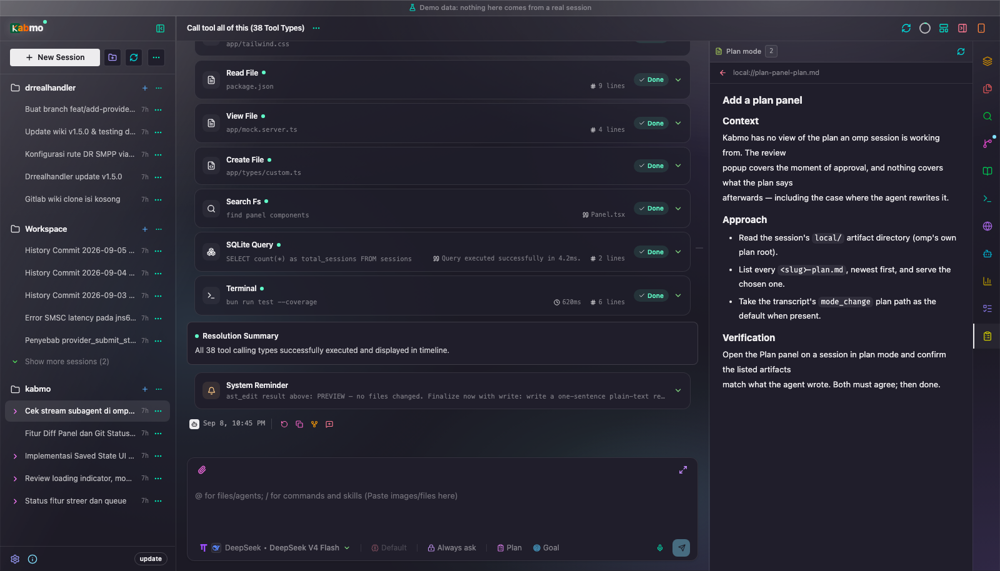<br>**Plan** — the plan artifact an omp session is working from, rendered as a document | 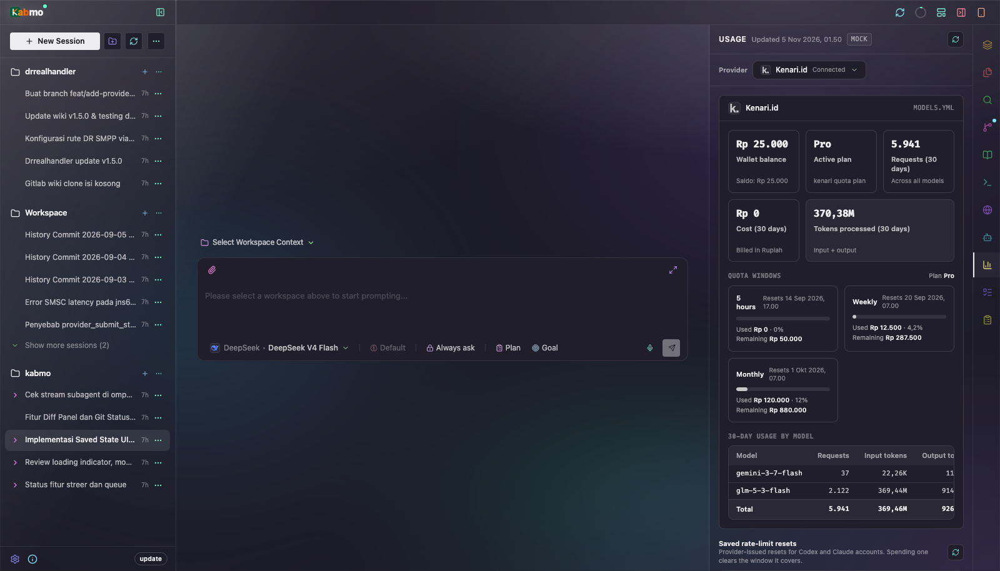<br>**Usage** — provider balance, plan windows, saved resets, per-model token spend |
| 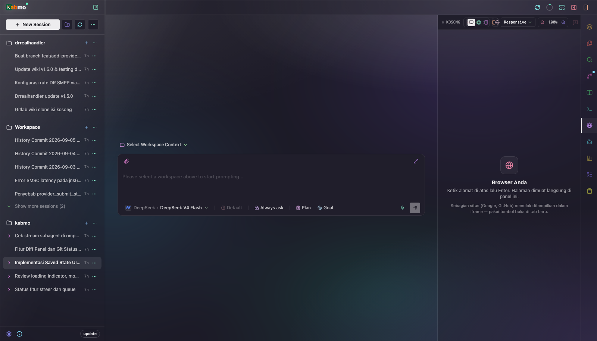<br>**Browser (yours)** — a private iframe with real history and device presets | 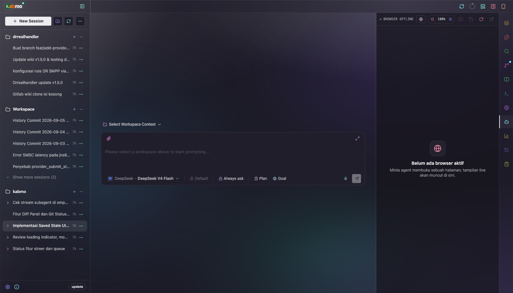<br>**Browser agent** — a live screencast of the tab the agent is driving |
| 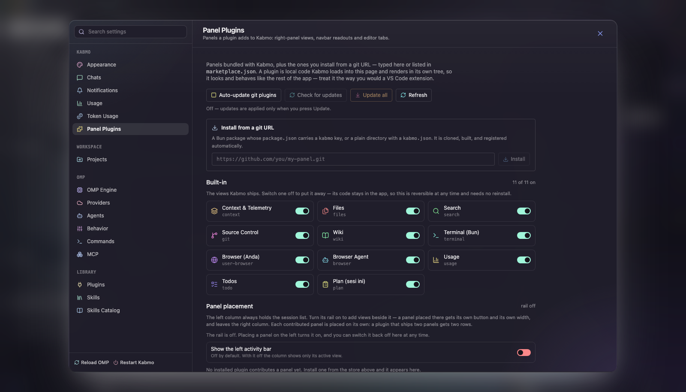<br>**Panel plugins** — every view is a plugin, the eleven built-in ones included | 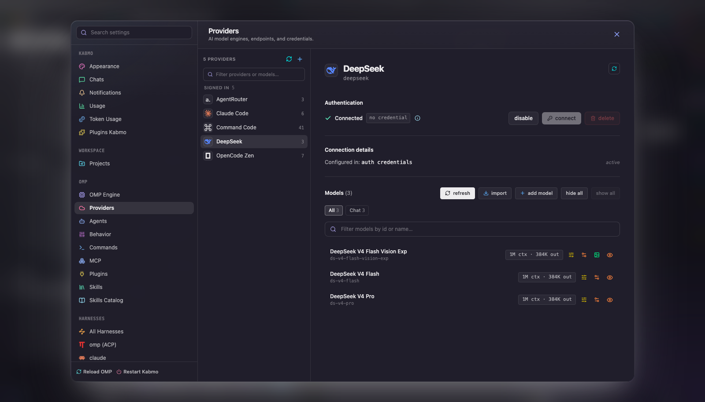<br>**Providers** — dialects, discovery, hand-added models, credential removal |
| 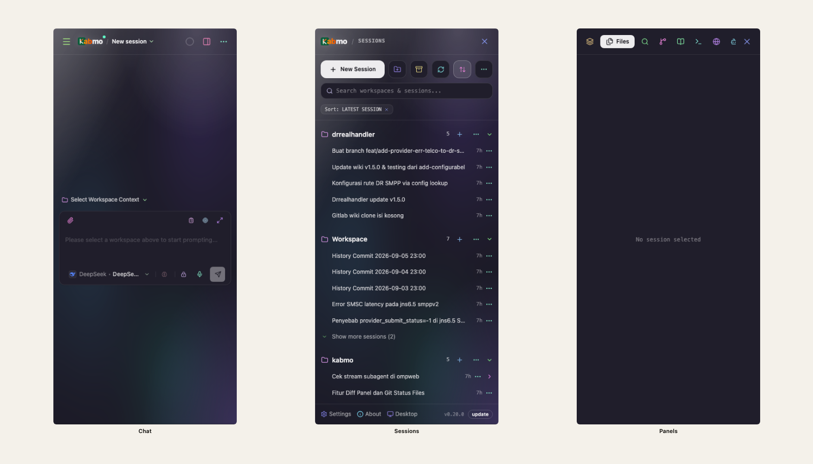<br>**Mobile view** — the same session on a phone: chat, sessions drawer, and the panel drawer | 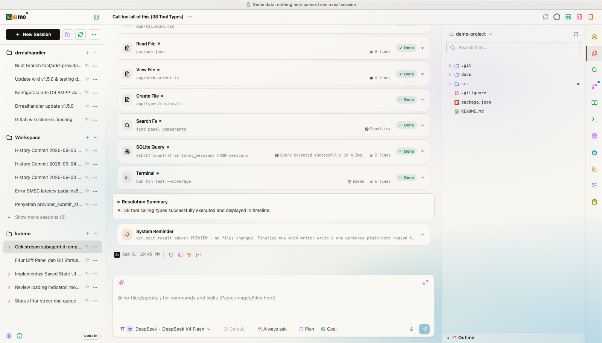<br>**Any palette** — 63 light and dark themes, applied to the whole console |

- **Chat timeline** — streaming thinking blocks (narrated prose promoted to answer text), a
  structured renderer per tool (bash, LSP, AST edit, `proc://` services, `wait` with a clock and
  progress, zoomable mermaid), usage footers, a persistent follow-up queue, a jump rail, drag-and-drop
  attachments, one-shot auto-titling, prompt recall on ArrowUp/ArrowDown and in-place undo that
  rewinds a session.
- **Steering, not cancelling** — a mid-run prompt is delivered INTO the running turn, so the answer
  you were watching survives. A subagent can be steered or stopped on its own.
- **Forks, child sessions and orchestration** — fork at any message or at the chat's tip, start child
  sessions from the composer, and hand work to another agent with an `@harness` mention; the sidebar
  draws parents and subagents as one branch, and every child's outcome returns as a turn in the
  parent.
- **Side questions** (`/btw [question]`) — answer from a private copy of the session file, without
  writing the parent transcript; a topic can be promoted into a session of its own.
- **Workspace sidebar** — folder → session tree off the project registry, with search, sort,
  archive, per-session stream status and harness mark, subagent rows, scheduled tasks, worktree
  sessions, and a New Workspace dialog that registers a directory or clones a repository.
- **Schedules, held prompts and notifications** — timezone-aware background tasks with their own
  harness and model, a chat's next prompt held until you release it (drafts restored on cancel), and
  desktop/mobile banners when a run finishes, waits for input or fails.
- **Eleven right-panel views, each a plugin** — context & telemetry, files, search, source control,
  wiki, terminal, your browser, the agent browser, usage, todos and plan; each remembers its own width
  per session. A plugin can ship a Preact view, a server half, storage, RPC methods, a realtime topic,
  a fenced-block renderer and settings; four are bundled (`command-runner`, `stats`, `session-info`,
  `git-forge`).
- **Files and editor** — multi-select with archive extract/compress, and a CodeMirror 6 editor with
  a symbol outline, fold guides, split view and Save As; spreadsheets edit in a cell grid, `.drawio`
  files render as diagrams, and an open tab follows disk changes by content hash.
- **The whole agent settings surface** — engine config generated from omp's own schema, providers,
  harnesses (launch line, env, models, modes), agents, `AGENTS.md` / `RULES.md`, slash commands, MCP
  servers with live connection tests, skills, token usage, notifications and dictation.
- **Self-update, opt-in auth, tray and dictation** — `kabmo update` and **About → Updates** restart
  into the new build (harness updates run as a background job with a readable log); a password and
  HTTPS are opt-in; `serve --tray` puts the icon in the menu bar; the composer's mic runs omp's own
  local speech-to-text.

## Themes

63 palettes in one catalog (`src/shared/lib/theme/`): Kabmo's own three (`paper`, `contrast`,
`one-dark-pro-soft`) and 30 light/dark pairs — Catppuccin, Gruvbox, Tokyo Night, Nord, Dracula,
Solarized, Kanagawa, Vesper, Ayu, Monokai, Everforest, Rose Pine, GitHub, Material, Vercel,
Cursor, OpenCode, Osaka Jade and more. Switching repaints everything, syntax highlighting and
Mermaid diagrams included, through one writer that sets `data-theme` and announces it — so an open
editor, a live terminal and a diagram in the transcript all follow with no reload. Every palette
carries the glass surface too: the frost is mixed from the palette's own paper and canvas, so no
theme needs a second set of colours for it.

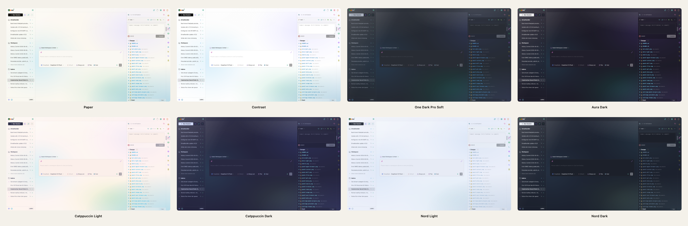

## Surfaces and icons

Two appearance axes sit on top of the palette, each one setting on the same shell — the same panels,
rows and dialogs, only cut from a different material:

- **Surfaces** (`surfaceStyle`) — `Classic` is opaque paper over the palette canvas: the sharpest
  text and the cheapest frame, and what an upgrade keeps. `Glass` is one frosted plane under a
  palette-tinted aura, with the panels above it as translucent tints. The plane owns the blur — a
  single `backdrop-filter` per window — so the panel count never decides the frame budget, and the
  frost is mixed from the palette's own paper and canvas, so no theme needs a second set of colours
  for it. A machine that reports no backdrop blur, or asks apps to reduce transparency, falls back to
  opaque panels and the settings card says which of the two it found.
- **Icons** (`iconStyle`) — `Monochrome` paints every icon in the surrounding ink. `Full colour`
  gives each one its own colour: functional glyphs a generated per-icon hue, provider and model marks
  their own brand colour, file-type marks their language's, and a project its accent. A brand colour
  that would vanish on the active variant (a black logo on a dark theme) keeps the ink instead, and
  the generated hues are stated at a lightness that clears the 3:1 non-text floor on every palette of
  that variant. Tool cards in a transcript stay ink — they are read, not scanned.

Both reach the document as attributes on `<html>` (`data-surface`, `data-icon-style`) and are read by
CSS only, so one setting repaints every surface — sidebar, navbar, composer, modal — without a prop
at any call site. The first frame is painted from the SSR shell, so a glass install never flashes
opaque.

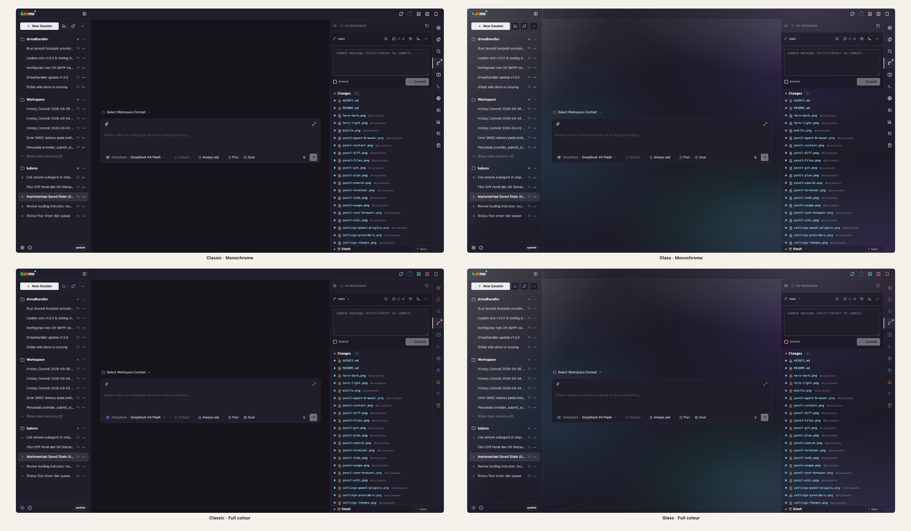

## Harnesses

A chat's **harness** is the agent behind it, and it is a first-class idea: a tab in the composer's
model dropdown, a mark beside the session in the sidebar, and a section in Settings.

| Harness | Transport | Notes |
|---|---|---|
| `omp` | RPC (`--mode rpc-ui`) | the default; the only path that reports todos, subagents, host tools, stats and compaction |
| `omp-acp` | ACP (`omp acp`) | the same agent over the adapter, with a slimmer surface |
| Claude Code, Codex, OpenCode, Command Code, deepseek-harness, Antigravity, MiniMax, pi, qwen, kimi, Cursor, ZCode, JCode, Grok | ACP over stdio | each launches its own CLI; models, modes, thought levels and MCP servers are probed from the agent, not hardcoded |
| your own | ACP over stdio | add a launch line in Settings → Harnesses |

Capabilities are probed, not assumed: the fork control appears only where the agent advertises
`session/fork` (at a message on omp, Claude Code and Codex; at the tip on OpenCode, MiniMax and
ZCode; nowhere else), and a harness that cannot fork says so instead of silently returning the tip.
The full measured matrix — every agent's transport, fork point, transcript store and known limits —
is in the **[Harnesses wiki page](https://github.com/kabmo-labs/kabmo/wiki/Harnesses)**.

## Install

Kabmo is published to npm and runs on **Bun 1.4+**, not Node. Live capabilities need the `omp`
binary on `PATH` (or `KABMO_OMP_BIN`) — the server refuses to boot without it — and any ACP harness
you want to use needs its own CLI installed and signed in. `MOCK=true` is the only mode that runs
without either.

```bash
bun install -g @oh-my-pi/pi-coding-agent   # omp is a prerequisite, never installed by Kabmo
bun add -g @kabmo-labs/kabmo               # puts the `kabmo` command on your PATH
kabmo serve                                # start the server on :3000
```

`kabmo serve` refuses to start without a resolvable `omp` and defaults to *not* installing one. On a
terminal it offers `bun install -g` once (answer `N` to skip); `kabmo doctor` reports the binary,
versions, data paths and install method without changing anything.

From a checkout:

```bash
git clone https://github.com/kabmo-labs/kabmo.git && cd kabmo
bun install && bun run build   # dist/client — the only build artifact
bun run start                  # or: bun link, then `kabmo status`
```

Updating, the full CLI reference, the tray and login entry, and multi-instance ports:
**[Installation →](https://github.com/kabmo-labs/kabmo/wiki/Installation)**

## Shells

The server is the product; a shell is a window on one. Every shell is thin — the client is
same-origin relative, so a system webview on the real `http://host:port` URL runs the unmodified
page — and every shell decides which server it is on, starts and stops a local one, and owns the
window chrome.

| Shell | Stack | Notes |
|---|---|---|
| macOS | Swift 6 + AppKit + WKWebView | 660 KB app, ~40 MB RSS; no runtime in the bundle |
| Windows | .NET 8 + WPF + WebView2 | `WindowChrome` owns the resize border |
| Linux | Rust + GTK 3 + WebKitGTK 4.1 | a port of the macOS shell, same contract |
| Android | Kotlin + platform WebView | viewer only; the server runs elsewhere |
| iOS | Swift 6 + UIKit + WebKit | viewer only; the Android shell is the reference |

The three desktop shells share the server list, the ownership rule and the bridge contract
(`src/client/lib/desktop/`); the two mobile shells are viewers because Kabmo's server needs `omp`,
a POSIX PTY, `git` and `rg` on the host. Each has its own release job.

## Configuration

Environment variables (`PORT`, `HOST`, `MOCK`, `KABMO_DATA_DIR`, `KABMO_OMP_BIN`, …), the SQLite
state and the two data modes: **[Configuration →](https://github.com/kabmo-labs/kabmo/wiki/Configuration)**

```bash
PORT=3001 kabmo serve          # one port, one process; a second instance never steals it
MOCK=true bun run dev          # demo datasets, no omp install needed
```

## Security

The UI is **open by default**; a password is supplied per run and hashed in memory, so nothing on
disk can enable authentication on its own.

```bash
kabmo serve --ui-password      # generates one and prints it once
kabmo serve --tls --ui-password …
```

Sessions are stateless HMAC cookies named per port, login is throttled per socket address, `--tls`
generates a self-signed certificate, and the terminal and dictation sockets are origin-checked.
Bind to loopback and reach it over SSH, a VPN or a tunnel — full detail in
**[Security →](https://github.com/kabmo-labs/kabmo/wiki/Security)**

## Architecture

```text
src/
├─ client/    Preact UI — zero React packages
├─ server/    Bun-only — Elysia routes, SQLite, omp RPC and ACP bridges, fs/git/terminal
├─ shared/    Imported by both — types, chat timeline folding, pure helpers
└─ cli/       kabmo command (plain ESM, runs under Bun)
packages/     kabmo-sdk (plugin contract) · kabmo-ui (Preact kit) · macos · windows · linux · android · ios
marketplace/  command-runner · stats · session-info · git-forge
```

[`AGENTS.md`](AGENTS.md) is the short binding contract for contributors and agents. The detail —
every subsystem, the invariants and the measured reason behind each one — lives in the
**[wiki](https://github.com/kabmo-labs/kabmo/wiki)**.

## Development

```bash
bun run dev            # watched server; the client bundle is built on demand
bun run dev:lan        # same, bound to the LAN
```

One process: Bun serves the HTML shell and bundles its assets itself, so there is no separate client
watcher and no build before the first request — a server save restarts, a client save is pushed over
HMR. `bun run build` writes `dist/client`, which `kabmo serve` runs.

Verification gates, all mandatory:

```bash
bun run lint                                                  # tsc --noEmit
bunx tsc --noEmit --noUnusedLocals --noUnusedParameters        # no dead code
bun run typecheck:consumer                                    # published .ts, no ambient types
bun run build                                                 # production bundle
bun test                                                      # unit + route suites
bun run typecheck:e2e                                         # the Playwright specs
```

`bun run check:fast` (`bun check --no-script`) is the same program on all cores in ~0.3 s instead of
~10 s. It is a local-loop convenience, not a gate: it uses Bun's own checker, whose verdict is not
interchangeable with `tsc`'s.

The browser layer is Playwright (`tests/e2e/`, `*.e2e.ts`) and boots a real server subprocess against
an isolated temp root per spec; `bun run test:e2e` runs it, and CI runs it nightly on `main`, on
label-gated pull requests, and as a gate of every release. The screenshots and GIFs in [`docs/assets`](docs/assets) are generated
by `bun run readme:media` against an isolated `MOCK=true` server, so they contain demo data only.

## Contributing

Issues and pull requests both get an automated first pass: a GitHub App runs the `omp` agent headlessly
to triage a new issue and to review a pull request, and its verdict is published as a `review:*` label.

- [`CONTRIBUTING.md`](CONTRIBUTING.md) is the policy — the mandatory gates, the pull request sections
  the reviewer checks, what counts as evidence, and the label a review moves through.
- The command surface is `@<bot> help | review | summarize | triage | reproduce` as the first line of
  a comment. Run the **bot config check** workflow to print the name this repository answers to.
- Bugs go through the issue form; requests through the feature form. Design and scope stay the
  maintainer's call, and [`AGENTS.md`](AGENTS.md) plus the wiki are the normative reference for the
  code rules.

## License

MIT — see [`LICENSE`](LICENSE). The terms cover the application and the published packages
(`@kabmo-labs/kabmo-sdk`, `@kabmo-labs/kabmo-ui`).

See [CHANGELOG.md](CHANGELOG.md) for the release history.
