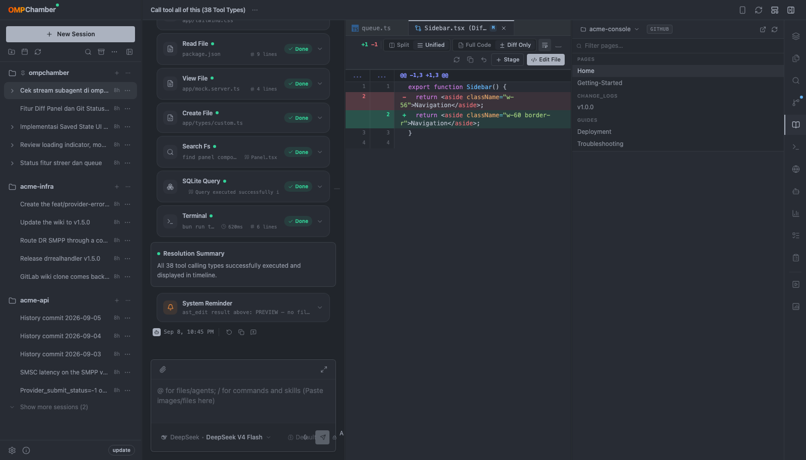
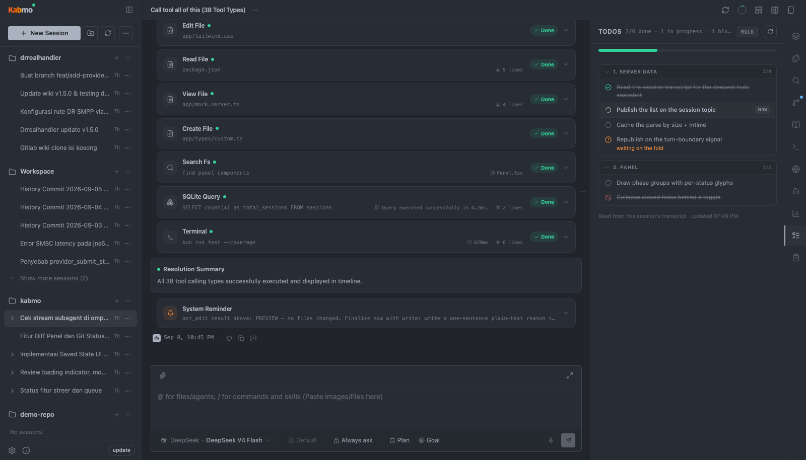
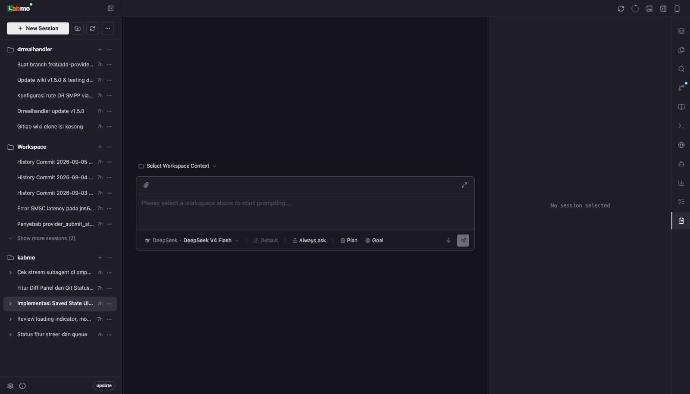
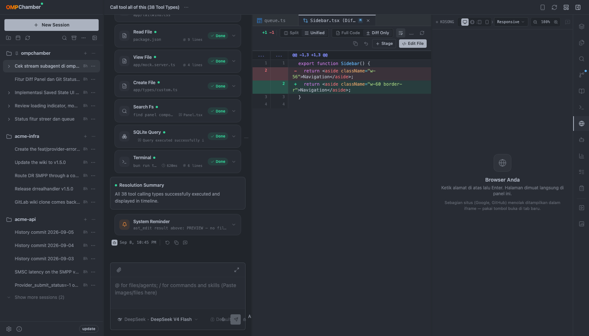
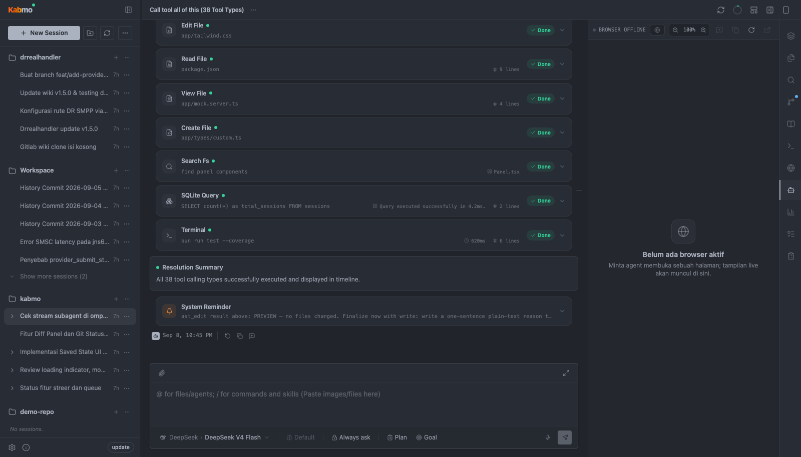
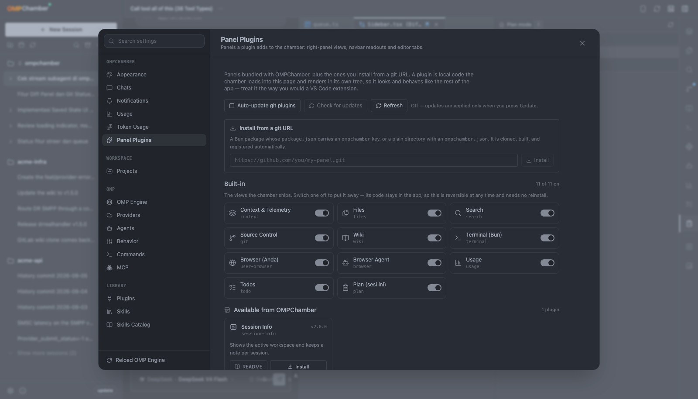
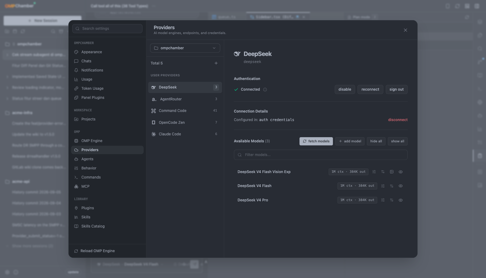

<p align="center">
  
</p>

<p align="center">
  Browser console and diagnostic workbench for <a href="https://github.com/can1357/oh-my-pi">Oh-My-Pi</a> (<code>omp</code>) agent sessions.<br>
  Watch, steer and audit autonomous coding sessions from one paper-flat dashboard.
</p>

<p align="center">
  <a href="https://www.npmjs.com/package/@kabmo-labs/kabmo"></a>
  <a href="https://bun.sh"></a>
  <a href="https://elysiajs.com"></a>
  <a href="https://preactjs.com"></a>
  <a href="https://shiki.style"></a>
  <a href="package.json"></a>
</p>

<p align="center">
  <a href="https://github.com/kabmo-labs/kabmo/wiki">Wiki</a> ·
  <a href="AGENTS.md">Architecture</a> ·
  <a href="DESIGN.md">Design</a> ·
  <a href="CHANGELOG.md">Changelog</a> ·
  <a href="docs/plugin-platform-plan.md">Plugins</a> ·
  <a href="https://github.com/kabmo-labs/kabmo/issues">Issues</a>
</p>


## What it is

The browser view onto a live `omp` install. It is not a terminal wrapper: Kabmo reads omp's own
session JSONL, project registry, config and subagent transcripts, folds them into one live view, and
writes back through omp's RPC mode.

```bash
kabmo serve                # production server + prebuilt client on :3000
bun run dev                # source checkout: one process, HMR, no build step
```

- **One process.** Elysia serves the API and the client bundle, and the agent event stream is a
  first-class WebSocket route on that same listener (SSE as fallback) — no second server, no proxy,
  no separate client watcher.
- **Two data modes.** `MOCK=false` (the default, also when unset) runs on the real SQLite database
  and your real workspace; `MOCK=true` swaps in bundled demo datasets. Every screenshot and
  recording on this page was captured in `MOCK=true`.
- **Bun only.** The server imports `bun:sqlite` and `Bun.YAML`, the client is bundled by `Bun.build`,
  and sessions, config and updates shell out to the `omp` binary.

## Feature tour


<sub>Full-quality recording (MP4, 23s): [docs/assets/tour.mp4](docs/assets/tour.mp4) · theme cycle in motion: [docs/assets/themes.gif](docs/assets/themes.gif)</sub>

| | |
|---|---|
| <br>**Files** — project tree with git markers, cut/copy/paste, drag-to-move, and a file open in the editor | <br>**Search** — ripgrep-backed streaming results, virtualized list, in-file jump and replace preview |
| <br>**Source Control** — changes, commits, branches, tracking, stash, and merge/rebase conflict resolution | <br>**Editor & diff** — split or unified, full-code or diff-only, word wrap, find/replace, command palette |
| <br>**Terminal** — a real PTY (one shell per terminal id, scrollback replayed on reload) | <br>**Context & telemetry** — context window use, cache hit rate, cost, per-message breakdown |
| <br>**Wiki** — reads a project's GitHub/GitLab wiki over git, with its own `_Sidebar` as navigation | <br>**Todos** — the session's live list, all five omp statuses, blockers and per-phase progress |
| <br>**Plan** — the plan artifact an omp session is working from, rendered as a document | <br>**Usage** — provider balance, plan windows, saved resets, per-model token spend |
| <br>**Browser (yours)** — a private iframe with real history and device presets | <br>**Browser agent** — a live screencast of the tab the agent is driving |
| <br>**Panel plugins** — every view is a plugin, including the eleven bundled ones | <br>**Providers** — dialects, discovery, hand-added models, credential removal |
| <br>**Mobile view** — the same session on a phone: chat, sessions drawer, and the panel drawer | <br>**Any palette** — 45 light and dark themes, applied to the whole console |

- **Chat timeline** — streaming thinking blocks (omp's narrated prose promoted to answer text), a
  structured renderer per tool (bash, LSP, AST edit, `proc://` services, `wait` with a clock and
  progress, zoomable mermaid), usage footers, a persistent follow-up queue, a jump rail, drag-and-drop
  attachments, one-shot auto-titling and in-place undo that rewinds a session.
- **Steering, not cancelling** — a mid-run prompt is delivered INTO the running turn, so the answer
  you were watching survives. A subagent can be steered or stopped on its own.
- **Side questions** (`/btw [question]`) — answer from a private copy of the session file, without
  writing the parent transcript; a topic can be promoted into a session of its own.
- **Workspace sidebar** — folder → session tree off omp's project registry, with search, sort,
  archive, per-session stream status, subagent rows, scheduled tasks, and a New Workspace dialog that
  registers a directory or clones a repository.
- **Eleven right-panel views, each a plugin** — context & telemetry, files, search, source control,
  wiki, terminal, your browser, the agent browser, usage, todos and plan; each remembers its own width
  per session. A plugin can ship a Preact view, a server half, storage, RPC methods, a realtime topic
  and settings; three are bundled (`Runner`, `Stats`, `Session Info`).
- **The whole omp settings surface** — engine config generated from omp's own schema, providers,
  agents, `AGENTS.md` / `RULES.md`, slash commands, MCP servers with live connection tests, skills,
  token usage, notifications and dictation.
- **Self-update, opt-in auth, tray and dictation** — `kabmo update` and **About → Updates** restart
  into the new build; a password and HTTPS are opt-in; `serve --tray` puts the icon in the menu bar;
  the composer's mic runs omp's own local speech-to-text.

## Themes

45 palettes in one catalog (`src/shared/lib/theme/`): Kabmo's own three (`paper`, `contrast`,
`one-dark-pro-soft`) and 21 light/dark pairs — Catppuccin, Gruvbox, Tokyo Night, Nord, Dracula,
Solarized, Kanagawa, Vesper, Ayu, Monokai and more. Switching repaints everything, syntax
highlighting and Mermaid diagrams included, through one writer that sets `data-theme` and announces
it — so an open editor, a live terminal and a diagram in the transcript all follow with no reload.


## Install

Kabmo is published to npm and runs on **Bun 1.4+**, not Node. Live capabilities need the `omp`
binary on `PATH` (or `KABMO_OMP_BIN`); `MOCK=true` is the only mode that runs without one.

```bash
bun add -g @kabmo-labs/kabmo   # puts the `kabmo` command on your PATH
kabmo serve                    # start the server on :3000
```

From a checkout:

```bash
git clone https://github.com/kabmo-labs/kabmo.git && cd kabmo
bun install && bun run build   # dist/client — the only build artifact
bun run start                  # or: bun link, then `kabmo status`
```

Updating, the full CLI reference, the tray and login entry, and multi-instance ports:
**[Installation →](https://github.com/kabmo-labs/kabmo/wiki/Installation)**

## Configuration

Environment variables (`PORT`, `HOST`, `MOCK`, `KABMO_DATA_DIR`, `KABMO_OMP_BIN`, …), the SQLite
state and the two data modes: **[Configuration →](https://github.com/kabmo-labs/kabmo/wiki/Configuration)**

```bash
PORT=3001 kabmo serve          # one port, one process; a second instance never steals it
MOCK=true bun run dev          # demo datasets, no omp install needed
```

## Security

The UI is **open by default**; a password is supplied per run and hashed in memory, so nothing on
disk can enable authentication on its own.

```bash
kabmo serve --ui-password      # generates one and prints it once
kabmo serve --tls --ui-password …
```

Sessions are stateless HMAC cookies named per port, login is throttled per socket address, `--tls`
generates a self-signed certificate, and the terminal and dictation sockets are origin-checked.
Bind to loopback and reach it over SSH, a VPN or a tunnel — full detail in
**[Security →](https://github.com/kabmo-labs/kabmo/wiki/Security)**

## Architecture

```text
src/
├─ client/    Preact UI — zero React packages
├─ server/    Bun-only — Elysia routes, SQLite, omp RPC bridge, fs/git/terminal
├─ shared/    Imported by both — types, chat timeline folding, pure helpers
└─ cli/       kabmo command (plain ESM, runs under Bun)
packages/     kabmo-sdk (plugin contract) · kabmo-ui (Preact kit)
marketplace/  command-runner · stats · session-info
```

[`AGENTS.md`](AGENTS.md) is the short binding contract for contributors and agents. The detail —
every subsystem, the invariants and the measured reason behind each one — lives in the
**[wiki](https://github.com/kabmo-labs/kabmo/wiki)**.

## Development

```bash
bun run dev            # watched server; the client bundle is built on demand
bun run dev:lan        # same, bound to the LAN
```

One process: Bun serves the HTML shell and bundles its assets itself, so there is no separate client
watcher and no build before the first request — a server save restarts, a client save is pushed over
HMR. `bun run build` writes `dist/client`, which `kabmo serve` runs.

Verification gates, all mandatory:

```bash
bun run lint                                                  # tsc --noEmit
bunx tsc --noEmit --noUnusedLocals --noUnusedParameters        # no dead code
bun run build                                                 # production bundle
bun test                                                      # unit + route suites
bun run typecheck:e2e                                         # the Playwright specs
```

The browser layer is Playwright (`tests/e2e/`, `*.e2e.ts`) and boots a real server subprocess against
an isolated temp root per spec; `bun run test:e2e` runs it, and CI runs it on every push to `main`
plus label-gated pull requests. The screenshots and GIFs in [`docs/assets`](docs/assets) are generated
by `bun run readme:media` against an isolated `MOCK=true` server, so they contain demo data only.

## Contributing

Issues and pull requests both get an automated first pass: a GitHub App runs the `omp` agent headlessly
to triage a new issue and to review a pull request, and its verdict is published as a `review:*` label.

- [`CONTRIBUTING.md`](CONTRIBUTING.md) is the policy — the mandatory gates, the pull request sections
  the reviewer checks, what counts as evidence, and the label a review moves through.
- The command surface is `@<bot> help | review | summarize | triage | reproduce` as the first line of
  a comment. Run the **bot config check** workflow to print the name this repository answers to.
- Bugs go through the issue form; requests through the feature form. Design and scope stay the
  maintainer's call, and [`AGENTS.md`](AGENTS.md) plus the wiki are the normative reference for the
  code rules.

## License

No license file is included. The source is public on GitHub and published to npm, but all rights are
reserved by the author — no license is granted for redistribution or reuse.

See [CHANGELOG.md](CHANGELOG.md) for the release history.
