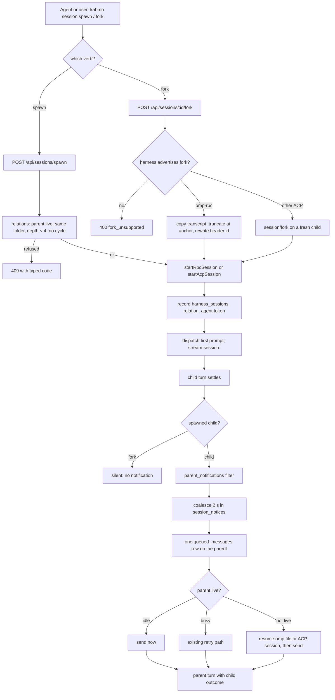
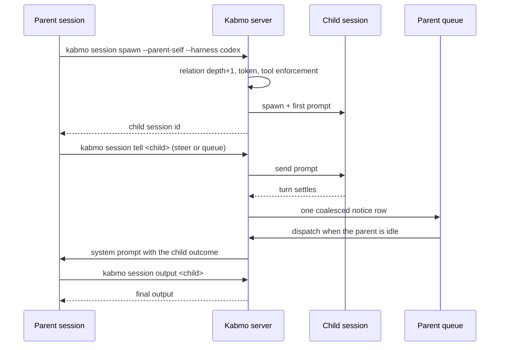

# M19 — Threads, forks and orchestration: reference implementations

Status: **done** — implemented: the session relation store, spawn, child-outcome notices, cold
dispatch, fork, delete cascade, agent tokens + `kabmo session` CLI, the sidebar separation and the
new-child action. Measured 2026-11-09: `claude` and `omp-acp` completed spawn → `session/fork` →
(tell) → wait; a deterministic fake-omp smoke proved cold wake (parent force-reset → child completed
→ 3 spawns, the third carrying the child-outcome prompt). Known upstream limits, recorded rather than
worked around: `zcode` advertises fork but refuses every tip fork (ACP exposes no checkpoint
parameter), and `opencode` probed `forkSession: false` on this build with a first turn that did not
settle in 90s.

One reference implementation is studied first, then the Kabmo mapping that follows from it. Append a
new case study when another repository is researched; Part II is what the case studies feed.

The first case study is `get-bb/bb` at `55135d1e` (2026-11-07), a shallow clone. Part I calls it
"the reference implementation"; its paths are relative to that checkout. Part II's paths are Kabmo's.

## Part I — Case study: threads, forks and orchestration

### The short answers

1. **Threads and forks are not the same feature.** A thread is the unit of work. A fork is one
   *origin kind* of thread: a new thread that clones the source provider session and inherits the
   source timeline up to a chosen completed turn. A spawned child is also a new thread, but it
   starts a fresh provider session with no inherited timeline and is linked by `parentThreadId`.
2. **"Orchestrator" is not a module, flag or thread type in the reference implementation.** It is the
   composition of the thread model: an agent inside a thread has the reference's CLI, can `spawn` /
   `tell` / `wait` on other threads, and the server queues child outcomes back into the parent. An
   index-wide search for `orchestrator` finds no implementation module — only product copy in
   `apps/web` (blog, comparison pages, testimonials), one automations story fixture, and provider
   recordings/tests that use the word incidentally.

### Source snapshot and one doc drift

- Clone: `git clone --depth 1 https://github.com/get-bb/bb.git`, HEAD
  `55135d1e5045d6c5d3c24f5a4d5556ed3e11cb00`, 2026-11-07.
- The authoritative user-facing model is the in-product guide the agent receives:
  `packages/templates/src/templates/bb-guide-threads.md`, `bb-guide-overview.md`,
  `bb-guide-thread-messaging.md`.
- **Doc drift worth knowing:** `docs/system-overview.md` still says a thread can be `standard` or
  `manager`. The `threads.type` column was dropped in `packages/db/drizzle/0023_wealthy_harpoon.sql`
  (after `0005` had already started assigning sort keys to `type = 'manager'`), and no current code
  reads a thread type. "Manager" survives as a usage pattern — a long-lived thread that coordinates
  others — not as stored state.

### 1. The model

| Entity | Role | Source |
|---|---|---|
| **Project** | Container, usually a repository; one or more sources, each bound to a host | `docs/system-overview.md` |
| **Thread** | Unit of work: one conversation with a provider, a lifecycle status, and an append-only event stream | `packages/domain/src/thread.ts` |
| **Environment** | Where a thread runs: a workspace directory bound to a host; unmanaged or managed (worktree/personal); several threads may share one | `docs/system-overview.md` |
| **Host** | Long-lived daemon identity for a machine that executes work | same |
| **Event** | The timeline: messages, tool calls, file changes, turns, provisioning, usage snapshots | `packages/db/src/data/events.ts` |

The thread DTO carries three relationships that are easy to confuse, and the reference keeps them deliberately
independent:

| Field | Meaning | Who reads it |
|---|---|---|
| `parentThreadId` | Sidebar nesting and parent notification edge | sidebar tree, `parent-system-messages.ts`, depth checks in `thread-parent.ts` |
| `sourceThreadId` + `originKind` | The thread was derived from another thread. `originKind` has exactly one value: `"fork"` (`packages/domain/src/thread-origin-kind.ts`) | the "Forks" section of the source thread's Info panel (`RelatedThreadsSection.tsx`) |
| `lifecycleOwnerThreadId` | Cleanup ownership: archive/delete the owner and the dependent follows. Set once at creation, immutable, may cross projects/hosts/environments | `docs/system-overview.md` §Thread lifecycle ownership; `packages/db/src/data/threads.ts` |

The DB insert encodes the first split directly
(`packages/db/src/data/threads.ts`, `createThread`):

```ts
parentThreadId: originKind === null ? (input.parentThreadId ?? null) : null,
sourceThreadId: input.sourceThreadId ?? (originKind === null ? null : (input.parentThreadId ?? null)),
```

The create service does the same one level up: `hierarchyParentThreadId` is only read when
`originKind === null`, and otherwise a supplied `parentThreadId` becomes `sourceThreadId`
(`apps/server/src/services/threads/thread-create.ts`). So a thread created with an origin kind is
never stored with a sidebar parent — a fork can only be reparented after creation with
`bb thread update --parent-thread`.

Lifecycle consequences, from `docs/system-overview.md` and verified against the cascade code:

- Archiving a `lifecycleOwnerThreadId` owner recursively archives dependents and stops them;
  unarchiving the owner does **not** restore them.
- Deleting a thread recursively deletes sidebar children and lifecycle dependents, including hidden
  and archived ones. Fork sources alone do not imply deletion.
- `stop` affects only the requested turn/runtime; it never cascades.

### 2. Threads

A thread is created in one of these ways; the first three are the ones that matter for the
thread/fork question:

| Path | Provider session | Inherited timeline | Relationship stored |
|---|---|---|---|
| New thread from the app/CLI | fresh | none | none |
| `bb thread spawn [--parent-self]` | fresh | none | `parentThreadId` (opt-in) |
| `bb thread fork <source>` | cloned from source | completed turns up to the anchor | `sourceThreadId` + `originKind: "fork"` |
| Handoff (follow-up model picker) | fresh | none; the prompt references `@thread:<id>` | none, or parent if requested |
| Side chat plugin | cloned | inherited like a fork | fork + `originPluginId: "side-chat"` + hidden |
| Workflow worker / plugin spawn | fresh | none | parent/owner as the plugin chooses |

#### Parent/child rules

- **Opt-in.** Inside a thread, `bb thread spawn` parents the new thread only with `--parent-self`
  (or an explicit `--parent-thread`). The CLI guide says the parent "may be in another project".
- **Depth is capped at 4** (`MAX_THREAD_HIERARCHY_DEPTH` in
  `apps/server/src/services/threads/thread-parent.ts`). Self-parenting and cycles are rejected; the
  check walks the parent chain and the child subtree.
- **Visibility and permissions inherit.** A child inherits the parent's visibility (hidden
  subagents stay hidden); subagents inherit the parent's permission mode, adapted to the child
  provider's supported modes, and nesting does not cap permissions — the host ceiling still applies
  (`bb-guide-threads.md`).
- **Environment defaults follow the parent.** A child of a live thread in the same project gets a
  worktree on the parent's machine; a child of an unmanaged non-Git folder reuses the parent's
  environment (`bb-guide-threads.md`).
- **Completion is reported, not polled.** `parentNotifications` filters what reaches the parent:
  `auto` (default) reports completed, failed and interrupted turns plus blockers; `stuck` skips
  completed turns; `off` reports nothing. A turn that only compacted the child is never reported.

The agent instruction is explicit about restraint (`plugins/bb-guide/introduction.ts`):

> Do not spawn new threads or message other threads unless the user has explicitly asked you to do
> so, except to answer a thread that messaged you.

And a child answers its parent in its **final response**; only when `bb status` shows
`Parent notifications: stuck` or `off` must it call `bb thread tell <parent>` instead.

### 3. Fork

#### What a fork is

`createThreadForkFromRequest` (`apps/server/src/services/threads/thread-fork.ts`) validates four
things, then delegates to the normal create path:

1. the source exists and is not deleted or archived;
2. the provider declares fork support (`supportsFork`);
3. the source has a ready environment;
4. the fork's environment names the source thread's **host** — `assertForkSourceHost` rejects a
   different machine because the provider session lives there.

The fork is created in the source thread's project, on the source provider, with the model,
reasoning level and service tier read from the source's **last execution options**, and the source's
permission mode unless overridden. By default it reuses the source environment; `--new-environment
personal`, `--new-environment worktree`, or another environment on the same host are allowed.

#### What is inherited

- **Provider session.** The daemon receives `thread/fork` with `sourceProviderThreadId` (and
  `sourceProviderCheckpointId` when the provider supports checkpoints) —
  `packages/provider-bridge-protocol`.
- **Timeline.** `copyForkSourceHistory` (`thread-fork-history.ts`) copies an explicit event list,
  not the whole log: `client/turn/requested`, `turn/started`, `turn/input/accepted`,
  `item/completed`, `item/backgroundTask/completed`, `turn/completed`, `thread/compacted`,
  `system/manager/user_message`. Only rows belonging to **completed** turns are kept, and copied
  rows get `providerThreadId: null` so the fork cannot re-claim the source's session identity.
- **Nothing else.** Identity, provisioning, usage snapshots, operations, streaming deltas (already
  folded into completed items), pending interactions, goal state and plugin state stay with the
  source.
- **Title.** An idle visible fork without `--title` is named after the source with a counted prefix:
  `foo` → `(1) foo` → `(2) foo`.

#### Where the timeline can be cut

- Default: **tip** — the session's latest completed turn.
- `--source-seq-end <seq>` / `sourceSeqEnd`: anchors on the completed turn **containing** that
  sequence; the clone and the inherited timeline both end at that turn's `turn/completed`. An anchor
  on a user message branches **before** it, like editing the message.
- Capability decides how precise the cut can be
  (`plugin-provider-registration.ts`: `fork: "none" | "tip" | "checkpoint"`):
  - `none` → `supportsFork: false`, the request is refused;
  - `tip` → `supportsFork: true`, `supportsSessionRewind: false`; an anchor is accepted only on the
    source's latest turn, otherwise `fork_source_session_unavailable`;
  - `checkpoint` → `supportsSessionRewind: true`; the turn must have recorded a provider checkpoint.
- The anchor turn must be complete. `resolveAnchoredForkPoint` refuses an incomplete turn, a turn
  with no provider session, and a completion recorded under another thread's session.

#### Fork entry points

- App: **Fork into new thread** on a message (`MessageActionBar.tsx`), which calls
  `useForkThreadFromMessage` with the message's `sourceSeqEnd`.
- CLI: `bb thread fork <source-thread-id> [--source-seq-end ...] [--prompt ...]`; omit `--prompt`
  for an idle fork.
- Side chat: a **hidden fork** (`visibility: "hidden"`, `originPluginId: "side-chat"`,
  `lifecycleOwnerThreadId` = the source) with an agent-only reply seed at the chosen message. It
  falls back to a tip fork when the anchored message predates any provider session
  (`plugins/side-chat/server.ts`).

#### Disambiguation

`docs/forkable-plugins.md` uses "fork" for copying a built-in plugin directory out of the repo.
That is unrelated to thread forks.

### 4. Thread vs fork, directly

| Question | Spawn / new thread | Fork |
|---|---|---|
| What it creates | A thread | A thread (origin kind `fork`) |
| Provider session | Fresh | Clone of the source, if the provider supports it |
| Timeline | Empty | Source's completed turns up to the anchor |
| Stored link | `parentThreadId` | `sourceThreadId` + `originKind`; `parentThreadId` null |
| Shows as | Sidebar child under the parent | "Forks" list in the source's Info panel |
| Parent gets notified | Yes, per `parentNotifications` | No — source-derived forks stay silent |
| Default environment | Parent's machine/workspace rules | Source environment, source host required |
| Typical use | Delegation and fan-out | Branching a conversation; side chat; "try again from here" |

Both are threads and every thread operation (`tell`, `wait`, archive, sections, visibility) applies
equally. The difference is **what the new thread starts with**, and which edge is recorded.

### 5. Orchestration

#### 5.1 There is no orchestrator component

Evidence from the snapshot:

- `rg -il orchestrator` hits `apps/web/src/blog/*`, `apps/web/src/compare/pages/t3-code.tsx`,
  `apps/web/src/landing/testimonials.tsx`, two provider recordings, and `plugins/automations`
  stories. No server, CLI, daemon or app module.
- `packages/domain/src/thread-origin-kind.ts` has one value, `fork`; there is no manager/worker
  thread type.
- The product definition lives in `docs/VISION.md` and the blog: the reference implementation is
  *"an agent orchestration tool for managing multiple agents"* (`bb-guide-overview.md`).

So "how the orchestrator works" is really "how the thread primitives compose". The answer is the
loop below.

#### 5.2 The loop

1. **Every thread is agent-operable.** The provider process gets
   `BB_PROJECT_ID` / `BB_THREAD_ID` / `BB_ENVIRONMENT_ID` / `BB_CLI`, the reference's guide chapters, and the
   instruction that its CLI is available "when you need BB context or orchestration"
   (`plugins/bb-guide/introduction.ts`, `bb-guide-overview.md`).
2. **An agent delegates by spawning.** `bb thread spawn --parent-self --project ... --provider ...
   --prompt ...` creates a child thread, records `parentThreadId`, provisions an environment, and
   dispatches the first prompt; the call returns the thread ID immediately while provisioning and
   the first turn continue asynchronously (`thread-create.ts`,
   `createPendingThreadAndAttemptFirstDispatch`).
3. **Child and parent exchange messages.** `bb thread tell <id> <message>` steers a live turn by
   default; `--mode queue` waits, `--mode auto` steers if active and starts a turn if idle. The
   parent can block on `bb thread wait <id>` and read `bb thread output <id>`. Messages from agents
   arrive prefixed `[bb message from thread:<id>]`.
4. **Outcomes are pushed back.** When a child turn ends, the server queues a system message into the
   parent's queue (`child-thread-notifications.ts`):
   - coalesced under the key `child-outcomes` with a **2 s** window, so a fan-out produces one
     "Child thread updates:" message instead of N turns;
   - a completed child contributes up to **4,000 characters** of terminal output, plus a note when a
     workflow it started is still running;
   - a failed/interrupted child contributes its failure context;
   - a blocked child sends the separate "needs help" template, asking the parent to resolve it from
     context or ask the user;
   - the queued row dispatches through the parent's normal queue (drain mode `auto`), so the parent
     starts a turn if idle and steers if running.
5. **The server only enforces invariants.** It does not choose a plan, a fan-out width or a provider.
   It enforces: live parent, no cycles, depth < 4, source host match for forks, visibility
   inheritance, permission adaptation, environment placement, queue durability, lifecycle
   ownership, and dispatch hooks.
6. **A human can intervene at any point.** Every worker is a real thread: open it, steer it, archive
   it, drag it onto another thread to reparent it, or open parent and child side by side.
7. **Durability is the queue, not the parent's context.** `sendAt` schedules a first message;
   automations wake an existing thread; a child that fails while a message is deferred delivers
   when retried.

#### 5.3 What the server enforces around delegation

| Concern | Mechanism |
|---|---|
| Runaway nesting | `MAX_THREAD_HIERARCHY_DEPTH = 4`; self/cycle rejection |
| Which outcomes wake the parent | `parentNotifications: auto \| stuck \| off`; compaction-only turns never notify |
| Notification storms | 2 s coalescing per parent (`CHILD_THREAD_TURN_NOTIFICATION_BATCH_DELAY_MS`) |
| Background workers in the sidebar | `visibility: hidden`; children inherit it; hidden threads stay addressable and still notify their parent |
| Orphaned workers | `lifecycleOwnerThreadId` archive/delete cascade, cross-project and cross-host |
| Permission escalation | Subagent inherits the parent's mode, adapted per provider; nesting does not cap; host ceiling applies |
| Fork on the wrong machine | `assertForkSourceHost` |
| Plugin interference | Message dispatch hooks can `proceed`, `wait` (with reason/`sendAt`) or `reject`; the first waiter owns the single queued row (`dispatch-hooks.ts`) |
| Provider session ownership | Copied fork rows null `providerThreadId`; a session claimed by another thread blocks the fork |

#### 5.4 The patterns the reference documents

| Pattern | Construction |
|---|---|
| Cross-provider reviewer | Parent spawns a different provider as a child, asks for a read-only review, waits, then fixes what it found (`apps/web/src/guides/pages/orchestrate-coding-agents.tsx`) |
| Fan-out | Several children under one parent; its own guide recommends it sparingly and limits practical width by quota/capacity, not by a scheduler |
| Long-lived manager | A normal thread with a skill and a growing conversation, woken by the Automations plugin; "a manager is a skill you can talk to" (`apps/web/src/blog/posts/building-a-restrained-software-factory.md`) |
| Code-defined orchestration | The Workflows plugin runs durable JavaScript that spawns workers and chooses a provider per worker |
| Side chat | Hidden fork that clones context for a detour and reports back without polluting the main timeline |

#### 5.5 Why it is shaped this way

The blog states the design goal: automate repetitive work while keeping **observability** and the
ability to take over. The implementation follows from that: the LLM is the scheduler, and the server
supplies first-class workers, durable queues and hard structural limits instead of a plan engine.
That is also why "manager" was never a stored type — it is a conversation the user keeps having, and
a type would have frozen a workflow that is supposed to evolve.

### 6. Implications if Kabmo imports any of this

Not a plan; the constraints a future design has to answer.

- **Fork is three capabilities, not one button.** Timeline copy up to a completed turn, a
  provider-level session clone/checkpoint, and a source edge that is *not* the sidebar parent. Missing
  the provider side leaves only "start a fresh thread that references the old one" (the reference's handoff).
- **Orchestration needs no separate service.** Parent edge + completion notification into the
  parent's queue + an agent-callable CLI covers the loop. The expensive parts are the invariants:
  depth, visibility, permission inheritance, host affinity, cleanup cascade.
- **Notification design is the product.** A 2 s coalescing window and a 4,000-character output
  excerpt are the difference between a usable parent context and a storm.
- **Machine affinity is a fork constraint, not an environment preference.** A cloned provider
  session pins the fork to the source host; the environment picker has to say so.
- **Naming.** The reference uses "fork" for history and "worktree" for filesystem; conflating them
  makes both impossible to explain.

### 7. Source map

| File | Establishes |
|---|---|
| `packages/templates/src/templates/bb-guide-threads.md` | spawn/fork/handoff semantics, defaults, lifecycle ownership, flags |
| `packages/templates/src/templates/bb-guide-overview.md` | the entity model and the "orchestration tool" definition |
| `packages/templates/src/templates/bb-guide-thread-messaging.md` | `tell` modes, parent reassignment, ownership |
| `apps/server/src/services/threads/thread-fork.ts` | fork validation and inherited execution defaults |
| `apps/server/src/services/threads/thread-fork-history.ts` | fork anchor resolution and the inherited event list |
| `apps/server/src/services/threads/thread-create.ts` | origin/parent/source wiring, host check, first dispatch |
| `apps/server/src/services/threads/thread-parent.ts` | depth cap, cycle checks, notification eligibility |
| `apps/server/src/services/threads/child-thread-notifications.ts` | outcome batching, excerpt limit, needs-attention message |
| `apps/server/src/services/threads/coalesced-system-notices.ts` | one queued row per coalesce key/window |
| `apps/server/src/services/threads/dispatch-hooks.ts` | plugin proceed/wait/reject decisions |
| `packages/db/src/data/threads.ts` | stored parent/source split and creation insert |
| `packages/db/drizzle/0023_wealthy_harpoon.sql` | removal of `threads.type` (the old manager type) |
| `apps/app/src/hooks/useForkThreadFromMessage.ts` | UI fork at a message's sequence |
| `apps/app/src/components/secondary-panel/info/RelatedThreadsSection.tsx` | "Child threads" vs "Forks" presentation |
| `docs/system-overview.md` | lifecycle ownership and sweep contracts; stale on `standard`/`manager` |
| `docs/forkable-plugins.md` | the unrelated meaning of "fork" |
| `apps/web/src/blog/posts/building-a-restrained-software-factory.md` | the three levels of orchestration and the manager pattern |

## Part II — The Kabmo mapping

This part maps the case study onto **this** codebase: what already exists in Kabmo, what has to be
added, where each piece lives, and how it is proven.

### 1. What already exists, and what does not

| Reference concept | Kabmo today | Gap |
|---|---|---|
| Thread | **Session** — an id whose truth is an omp JSONL file (`findSessionFileById`) or an agent-owned ACP session (`harness_sessions`) | none |
| Thread status / event stream | `session_stream_state` + the live registry + realtime `session:<id>` topic | none |
| Project | `workspace_folders` (one sidebar section) | none |
| Environment | a session's `cwd`, the worktree registry, `SessionItemData.cwd` | none |
| `parentThreadId` | none | **new relation store** |
| `lifecycleOwnerThreadId` | none | **new relation store** |
| `sourceThreadId` + `originKind` | none in Kabmo; omp's header has `parentSession` (a **path**, read as `parentSessionId`) | **new relation store**; do not trust the omp field for identity |
| Fork | ACP verb `session/fork` exists (`src/server/lib/harness/acp/verbs.ts`), capability `forkSession` is probed, but **no route calls it**; omp has `truncateSessionBody` + transcript-copy patterns used by BTW promotion | **fork service + route + UI** |
| Parent notified on child end | turn settle exists on both transports (`terminal-settle.ts`, `settleAcpTurn`) | **notification pipeline** |
| Durable queue | `queued_messages` + `delivery.server.ts` (claim, retry, stale-timer recovery) | dispatcher assumes a **live** session |
| Cold start for a deferred prompt | `waiting/runtime.server.ts` spawns omp only, from a stored cwd | **harness-aware dispatcher** |
| Agent-callable CLI | `kabmo` has `serve/update/stop/restart/status/doctor/logs/plugin` | **`kabmo session` + agent auth** |
| Sidebar nesting | a session row already expands into omp **native subagents** (`SubagentList`) | **child sessions, distinct from native subagents** |
| Archive / delete cascade | `archived_sessions`, `purgeSessionData`, `removeSession` | **follow relations** |
| Hidden workers | none | **visibility on relations** |

Two mechanisms will coexist: omp's **native subagents** (the `task` tool writes artifacts under a
session; Kabmo shows them in `SubagentList`) and **child sessions** (a real Kabmo session created by
an agent or the user). The UI must label them differently; one is a tool call, the other is a chat.

### 2. Decisions

- **D1 — A relation table, not columns on a sessions table.** Kabmo has no canonical sessions table:
  omp sessions are files, ACP sessions are agent-owned. A relation keyed by `session_id` works for
  both and survives a restart.
- **D2 — Fork is a creation path, never a mutation.** The source session is never rewritten. omp
  rewinds in place today because Undo is a different feature; a fork writes a **new** file.
- **D3 — No orchestrator service.** The agent is the scheduler. The server owns invariants (depth,
  host/cwd, permissions, cleanup) and durable delivery.
- **D4 — Outcomes arrive as queued system messages.** Not a socket, not a callback into a live turn.
  They coalesce, survive a restart, and wake an idle parent.
- **D5 — Refuse, never substitute.** An unsupported fork or a dead cold-start names the reason; it
  never silently starts a fresh session under the old id.
- **D6 — No "manager" type.** A manager is an ordinary long-lived session plus a skill plus the
  existing scheduler; nothing new is stored.
- **D7 — omp and ACP fork differently.** omp: copy the transcript, truncate at the anchor, rewrite
  the header id, resume the copy. ACP: `session/fork`. ACP agents that do not advertise `fork` are
  refused (`fork_unsupported`), not downgraded to a handoff.
- **D8 — Cross-folder parenting stays out of v1.** Storage allows it; the route refuses a parent in
  another `workspace_folders` row (`parent_folder_mismatch`) because the sidebar is grouped by
  folder and a cross-folder child has no place to render. Revisit with a "Subsessions" section.
- **D9 — Child sessions share the parent's cwd in v1.** Creating a worktree per child is the
  existing worktree-session flow, not an implicit side effect of spawn.

### 3. Storage

```
                    ┌──────────────────────────────────────────────┐
                    │ workspace_folders                            │
                    │   id ── groups ──▶ session rows              │
                    └───────────────────┬──────────────────────────┘
                                        │
        ┌───────────────────────────────▼───────────────────────────────┐
        │ session (id)                                                  │
        │   omp-rpc : <sessions-root>/<ts>_<id>.jsonl                   │
        │   ACP     : agent-owned id, recorded in harness_sessions      │
        └───────┬──────────────────────┬──────────────────────┬─────────┘
                │                      │                      │
      parent edge                      │ source edge          │ cleanup edge
                ▼                      ▼                      ▼
        session_relations        session_relations      session_relations
        parent_session_id        source_session_id      lifecycle_owner_session_id
        (sidebar + notify)       origin_kind='fork'     (archive/delete cascade)
```

One row per session, three nullable edges. `depth` is stored so a cycle check is a walk up, not a
subtree scan.

```sql
CREATE TABLE IF NOT EXISTS session_relations (
  session_id                 TEXT PRIMARY KEY,
  parent_session_id          TEXT,
  lifecycle_owner_session_id TEXT,
  source_session_id          TEXT,
  origin_kind                TEXT,                 -- 'fork' | NULL
  visibility                 TEXT NOT NULL DEFAULT 'visible',   -- visible | hidden
  parent_notifications       TEXT NOT NULL DEFAULT 'auto',      -- auto | stuck | off
  depth                      INTEGER NOT NULL DEFAULT 0,
  created_at                 INTEGER NOT NULL
);
CREATE INDEX IF NOT EXISTS idx_session_relations_parent  ON session_relations (parent_session_id);
CREATE INDEX IF NOT EXISTS idx_session_relations_owner   ON session_relations (lifecycle_owner_session_id);
CREATE INDEX IF NOT EXISTS idx_session_relations_source  ON session_relations (source_session_id, origin_kind);

-- Coalescing buffer. Rows exist only inside the window; delivery turns one into
-- a queued_messages row and deletes it.
CREATE TABLE IF NOT EXISTS session_notices (
  id                TEXT PRIMARY KEY,
  parent_session_id TEXT NOT NULL,
  coalesce_key      TEXT NOT NULL,                 -- 'child-outcomes'
  state             TEXT NOT NULL,                 -- JSON array of outcome items
  send_at           INTEGER NOT NULL,
  created_at        INTEGER NOT NULL,
  updated_at        INTEGER NOT NULL
);
CREATE UNIQUE INDEX IF NOT EXISTS idx_session_notices_window
  ON session_notices (parent_session_id, coalesce_key);

-- One bearer token per session, minted at spawn and injected into the agent's
-- environment. Stored hashed; revoked on session delete.
CREATE TABLE IF NOT EXISTS session_agent_tokens (
  session_id TEXT PRIMARY KEY,
  token_hash TEXT NOT NULL,
  created_at INTEGER NOT NULL,
  revoked_at INTEGER
);
```

Why not extend `queued_messages`: the client renders that table as **the user's** follow-up queue
(editable, reorderable). A system notice must not be editable or reorderable, and it has a different
relevant field set (outcome kinds, child mentions). The notice table owns coalescing; the queue owns
delivery. `queued_messages` stays unchanged.

### 4. The three flows

#### 4.1 Spawn — a child session

```
agent / user
    │  kabmo session spawn --parent-self --harness codex --prompt-file -
    ▼
POST /api/sessions/spawn
    │
    ├─▶ relations.assertParent(parent, folder)     live, same folder, depth < 4
    ├─▶ resolve harness + cwd + model              explicit, else parent defaults
    ├─▶ startRpcSession / startAcpSession          existing spawn paths
    ├─▶ saveHarnessSession                         ownership for the sidebar
    ├─▶ mint agent token + relation row            depth = parent.depth + 1
    └─▶ dispatch first prompt                      session:<id> streams to the sidebar
```

Refusals are typed, not prose-only: `parent_not_found`, `parent_archived`, `parent_folder_mismatch`,
`depth_exceeded`, `cycle`, `harness_unavailable`, `spawn_failed`.

The child inherits the parent's harness and cwd **unless an explicit flag says otherwise**. Model and
thinking level come from the parent when it is live, else from the omp transcript
(`model_change` / `thinking_level_change`) or `session_stream_state`'s recorded model; a value that
cannot be read falls through to the project/default resolution rather than being invented.
Permission mode is the other exception: Kabmo persists access mode globally
(`loadPersistedAccessMode`), not per session, so spawn uses the persisted mode (or an explicit flag)
until a per-session record exists. Cross-harness is the point of the feature (one agent asks another
to review), so the harness flag is first-class rather than a settings toggle.

#### 4.2 Fork — a branch of a session

```
                  ┌──────────────────┐
                  │ source session   │
                  └────────┬─────────┘
                           │ anchor = a turn's entry id (default: tip)
          ┌────────────────┴─────────────────┐
          │                                  │
   harness = omp-rpc                  harness = ACP
          │                                  │
   copy transcript file                call session/fork on a fresh child
   truncate at anchor's turn           (capability forkSession must be true)
   rewrite session header id
   write new <ts>_<id>.jsonl
          │                                  │
          └────────────────┬─────────────────┘
                           ▼
             new session + relation row
             origin_kind = 'fork', source_session_id = source
             parent_session_id = NULL  (a fork is not a sidebar child)
```

- The anchor is an **entry id**, not a sequence number. Kabmo has no global event sequence; its
  rewind route already selects a cut by `entryId` (`chat/rewind.ts`), and the same cut rules apply.
- omp keeps the inherited timeline in the copied file. The header's `parentSession` is written as
  the source **path** (that is what omp itself writes); Kabmo's identity edge lives in
  `session_relations`.
- ACP delegates history to the agent: the fork returns a new agent session id, and a later
  `session/load` replays it. **Verified before implementation:** whether each harness's
  `session/fork` works from a fresh child process, and whether its replay contains the source turns.
  A harness that advertises `fork` but fails at runtime surfaces `fork_failed`; no fallback.
- `omp-acp` is a special case already documented in `harness-command.ts`: `session/load` on omp
  **forks** (measured). That behaviour is desirable for an explicit fork and unacceptable for a
  resume; keep them in separate code paths so the resume rule cannot regress.
- A fork created from an agent (`--parent-self`) should also record `parent_session_id`? **No.**
  Like the reference, the fork edge is the source edge; a parent notification is about delegation, not
  derivation. A user can reparent later.

#### 4.3 Notify — the child outcome reaches the parent

```
child turn settles
  (terminal-settle.ts  |  settleAcpTurn)
        │
        ▼
session_relations: parent_session_id IS NOT NULL AND origin_kind IS NULL
        │
        ├─ parent_notifications = off   ──▶ nothing
        ├─ stuck                         ──▶ failures, interruptions, blockers only
        └─ auto                          ──▶ every finished / failed / interrupted turn
        │
        ▼
session_notices  (upsert by parent + 'child-outcomes', window 2 s)
        │  window closes
        ▼
one queued_messages row on the parent
        │
        ▼
session dispatcher
        ├─ parent live + idle  ──▶ send now
        ├─ parent live + busy  ──▶ existing retry path (2 s)
        └─ parent not live     ──▶ resume (omp file | ACP session/load) ──▶ send
        │
        ▼
parent turn receives:
  [kabmo system] Child session @session:<id> completed:
  <final output, truncated at 4 000 chars>   (or "No final output was recorded.")
```

Rules that are load-bearing:

- **Only spawned children notify.** A fork has no `parent_session_id`, so it is silent; so is a
  child whose `parent_notifications` is `off`.
- **Coalesce per parent.** A fan-out produces one message per 2 s window, not one turn per child.
  The window key is `(parent_session_id, 'child-outcomes')`.
- **A blocked child is a separate notice** ("needs help") that names the pending interaction and
  asks the parent to resolve it or ask the user. It is not a "completed" line.
- **Cold wake is mandatory.** The whole point of a long-lived manager is that it is idle when its
  children finish. The dispatcher must resume the parent's own harness, not just the omp queue path.
- **No excerpt is better than a wrong one.** For an ACP parent that is not live, the final text may
  not be readable without a resume; the notice then says so and names the session to inspect. This
  is a reported state, never a fabricated "completed".

#### 4.4 Mermaid flowchart



#### 4.5 Mermaid sequence



### 5. API, agent auth and CLI

#### 5.1 Routes

Register the static path **before** the `:sessionId` routes, the same rule that puts
`/api/sessions/batch-archive` first in `routes/sessions/index.ts`.

The `/api/sessions/:sessionId` segment is **already a folder id**, not a session id: its loader is the
legacy "sessions belonging to one workspace folder" route, and it is named `sessionId` only because
Elysia requires one parameter name per path position. A new `/api/sessions/:sessionId/fork` must use
that same name. The transcript lives at `/api/chat/:sessionId`, not `/api/sessions/:sessionId`.

| Method + path | Body / query | Answers |
|---|---|---|
| `POST /api/sessions/spawn` | `parentSessionId?`, `harness?`, `cwd?`, `prompt`, `model?`, `thinkingLevel?`, `accessMode?`, `visibility?`, `parentNotifications?`, `lifecycleOwnerSessionId?` | `{ sessionId, parentSessionId, harness, depth }` |
| `POST /api/sessions/:sessionId/fork` | `anchorEntryId?`, `prompt?`, `harness?`, `cwd?`, `visibility?` | `{ sessionId, sourceSessionId }` |
| `GET /api/sessions/:sessionId/relations` | — | `{ parent, children[], forks[], lifecycleOwner }` |
| `POST /api/sessions/:sessionId/parent` | `parentSessionId \| null` | `{ ok }` (reparent; revalidates depth/folder) |
| reuse `POST /api/agent/:sessionId` | existing prompt send | `tell` is an existing send with a delivery mode |
| reuse `GET /api/chat/:sessionId` | — | `output` is the existing transcript read |
| reuse `POST /api/sessions/:sessionId/archive`, `DELETE /api/sessions/:sessionId` | — | now cascade through relations |

`tell` needs no new route: `/api/agent/:sessionId` already sends a prompt, and the queue already
separates steer from queue. What is missing is **authorization** for an agent process to call it.

#### 5.2 Agent token

- At spawn, generate 32 random bytes, store `sha256` in `session_agent_tokens`, inject the plaintext
  as `KABMO_AGENT_TOKEN`, plus `KABMO_SESSION_ID` and `KABMO_SERVER_URL`, through the existing
  `childEnv(overrides)` / ACP `options.env` seams.
- `authGate` stays the authority for browser routes. Add a second, narrow predicate used only by the
  orchestration route group: `Authorization: Bearer <token>` whose hash matches a non-revoked row.
  Scope it to this session's own operations (spawn under it, tell itself, read its subtree, fork
  itself); it is not a UI session and not an admin credential.
- The token exists even when UI auth is off. It is **not** a boundary against the same OS user — that
  user can read the database — it prevents accidental cross-session control and keeps the route
  contract identical in both auth modes. Say this in the route doc comment instead of implying more.
- It dies with the session: `purgeSessionData` deletes the row; archive does not revoke (an archived
  session is restorable).

#### 5.3 CLI

Add `session` to the command list in `src/cli/main.js`, with the implementation in
`src/cli/lib/commands/session.js` (same shape as the existing commands: `run(options, ctx)`,
`--json`, `fail()` on refusal).

```
kabmo session spawn   --prompt-file - [--parent-self] [--harness <id>] [--title ...] [--json]
kabmo session fork    <source-id> [--anchor-entry <id>] [--prompt-file -] [--json]
kabmo session tell    <id> --message-file - [--mode steer|queue|auto]
kabmo session wait    <id> [--idle] [--timeout 10m]
kabmo session show    [id] [--json]
kabmo session output  <id> [--json]
kabmo session relations <id> [--json]
```

`KABMO_SESSION_ID` makes `--parent-self` and a bare `show`/`output` resolve to the calling session,
mirroring `BB_THREAD_ID`. Long prompts come from `--prompt-file -` / `--message-file -`, never inline.

#### 5.4 Agent instructions

Kabmo has no per-session system-prompt injection across harnesses: omp has config-level prompts,
ACP has no generic one, and the composer's first prompt is the only universal channel. v1 therefore
does **not** claim parity with the reference's injected guide. Two honest options, decided per harness later:

1. the spawning prompt states the contract ("use `kabmo session spawn --parent-self`; report back in
   your final message"), and
2. `kabmo session --help` is the reference the agent can read.

Do not write an instruction file into the user's repo behind their back.

### 6. UI

The chevron must not mean two things. A **child session is a session**, so it belongs at list
level as a tree node. A **native subagent is a tool call**, so it stays a compact artifact list and
never becomes a session row. Rendering both inside one chevron makes the two indistinguishable and
is rejected here.

```
Child sessions (tree node)                 Native subagents (trailing badge → popover)
┌──────────────────────────────────┐       ┌──────────────────────────────────┐
│ ▾ Fix emoji filenames     omp    │       │ Fix emoji filenames   omp  ⚙2    │
│    ├ Review the diff     codex ● │       │   task: explore       done       │
│    │   └ Release notes   claude ○│       │   task: verify        running    │
│    └ Ask Cursor          cursor  │       └──────────────────────────────────┘
└──────────────────────────────────┘
      row navigates to /sessions/:id         row opens a transcript, not a session
```

- **One canonical position.** `loadSidebarStructure` excludes a nested child from the folder's root
  rows; the tree is the only place it appears. A "Flatten" filter (and search results) may list it
  flat, but then it is not drawn twice in the same view.
- **Chevron = tree disclosure** for child sessions only. Deep nesting is capped visually (two
  levels plus "N more"), while storage still allows four.
- **Subagents = badge + popover**, never a tree row. The existing `SubagentList` keeps its fetch but
  its trigger moves from the chevron to a trailing badge (or the info panel); `hasSubagents` becomes
  a count. A subagent row opens `?subagent=…`, not a session.
- **Different row grammar.** A child row draws the full session row: harness mark, title, live
  status, timestamp, actions menu. A subagent row draws a task name and status only — no session
  actions, no navigation to a session.
- **Session row**: add `childSessionCount` and `parentSessionId` to `SessionItemData`; the parent
  row shows the chevron only when `childSessionCount > 0`.
- **Session header**: a parent breadcrumb when `parent_session_id` exists, and a **Forks** count in
  the info panel (the analogue of the reference's "Forks" section).
- **Message action**: "Fork from here" beside Copy/Retry, posting the message's entry id as the
  anchor. This is the only fork affordance needed; the header can offer "Fork at tip".
- **New child session**: a command-palette action and a session-menu item, both opening the existing
  composer's harness picker; they call `POST /api/sessions/spawn` with `--parent-self` semantics.
- **Child controls**: child sessions reuse the ordinary session actions (stop, steer, archive)
  because they are ordinary sessions. Native subagents keep `subagent-control.ts`; the two control
  sets are not merged.
- **Mobile**: a flat list with an indent and a parent label, and the subagent badge as a separate
  entry point — no nested chevron on a phone.
- **Hidden sessions** (visibility `hidden`) are excluded from `loadSidebarStructure` unless a flag
  asks for them, but remain addressable by id and still notify their parent.

Why not labels inside one chevron: the click target and the destination differ (navigate to a
session vs. open a transcript), and the rows carry different actions. A label does not fix a
misleading affordance; two controls do.

### 7. Lifecycle and invariants

| Invariant | Where it is enforced |
|---|---|
| Parent exists, live, same folder | `relations.assertParent` at spawn/reparent |
| No self-parent or cycle | relation walk with the `depth` column |
| Depth ≤ 4 | `depth = parent.depth + 1`; refuse at 5 |
| A fork is not a child | fork writes `source_session_id`, leaves `parent_session_id` null |
| Fork sources stay silent | notify query requires `origin_kind IS NULL` |
| Notifications filter | `parent_notifications` before the coalescing insert |
| Stop does not cascade | stop acts on one session, as today |
| Archive cascades by owner | archive route walks `lifecycle_owner_session_id` before archiving |
| Delete cascades by owner **and** parent | `removeSession` walks both edges, children first |
| Deleting a fork does not touch its source | only `source_session_id`; never a cascade edge |
| Hidden child still reports | visibility is presentation, `parent_notifications` is delivery |
| Cleanup on purge | `purgeSessionData`'s table list gains relations, notices, tokens (both directions) |

Archive and delete are the two places where a missed edge is silent and destructive. Both must be
tested with a three-level chain and with an archived intermediate.

### 8. Phases

| Phase | Delivers | Proven by |
|---|---|---|
| **P0** | `session_relations` + schema bootstrap + read routes + tests | unit: depth, cycle, folder refusal; route test |
| **P1** | `POST /api/sessions/spawn` (live parent), relation write, first prompt, sidebar `childSessionCount` + `ChildSessionList` | route test + real smoke: spawn from a parent, open the child, see it nested |
| **P2** | turn-settle notification, `session_notices` coalescing, queue row, typed notices | unit: merge window, `off`/`stuck`; real smoke: idle parent receives one message for two children |
| **P3** | cold dispatcher (shared with waiting prompts), parent woken when not live | unit: no live session path; real smoke: close the parent tab, child finishes, parent resumes and answers |
| **P4** | omp fork (copy + anchor + new header), ACP fork, refusals, fork UI | unit: anchor cut, header rewrite, unsupported capability; real smoke for each supported harness |
| **P5** | `kabmo session` CLI + agent token + route guard; archive/delete cascade; mobile | CLI test against a temp server; route tests for token scope; cascade test |

Each phase updates every caller and doc line it changes, and runs the §2 verification gates in
`AGENTS.md` once at the end. No phase writes CHANGELOG.

#### Acceptance criteria for "done"

1. An agent in a session can run `kabmo session spawn --parent-self --harness <other> --prompt-file -`,
   receive a session id, and later receive that child's outcome as a system message in its own
   timeline.
2. Two children finishing within the coalescing window produce **one** parent turn, with both
   outcomes.
3. A child that ends while the parent is closed wakes the parent **on its own harness** and produces
   the same message.
4. Forking an omp session at a user turn produces a new session whose transcript ends at that turn,
   whose header id is new, and whose sidebar row exists exactly once; the source is unchanged.
5. Forking a harness that does not advertise `fork` answers a typed refusal and starts nothing.
6. Archiving an owner archives its dependents; deleting it removes them; deleting a fork leaves its
   source intact.
7. `bun run lint`, `bunx tsc --noEmit --noUnusedLocals --noUnusedParameters`, `bun run build`,
   `bun test`, `bun run typecheck:e2e` pass, and no file crosses 350 lines.

### 9. Risks and open questions

- **ACP fork semantics are per harness.** `forkSession` is probed, but "advertised" is not "works
  from a fresh process". P4 must measure at least omp-acp, claude and codex before shipping the
  button, and each refusal must name the harness.
- **ACP history after the process dies.** Kabmo reads an omp JSONL; an ACP transcript exists only
  while the agent can `session/load` it. A fork's timeline is therefore agent-owned, and the UI must
  not imply Kabmo owns a copy.
- **Two identity systems.** For ACP, the session id may be the agent's own; for omp it is Kabmo's.
  `saveHarnessSession.agentSessionId` exists for exactly this. Relations must key on the id the
  sidebar and URL use, never on a provider id.
- **omp's `parentSession` is a path.** `reader.ts` copies it into `parentSessionId`; do not join on
  it. The relation table is the identity edge.
- **Notification storms.** Coalescing bounds them, but a parent with a large fan-out still receives
  one turn per window. The excerpt cap and the "inspect the session" wording are the pressure valve.
- **Token scope.** A local process can read the database. The token is a routing/ownership guard,
  not a security boundary; state that in code and docs.
- **Hidden children and the UI.** A hidden child must still be reachable from its parent's relations
  panel, or the feature creates work the user cannot see.

### 10. File map

| New / changed | Purpose |
|---|---|
| `src/server/lib/sessions/schema.server.ts` (new) | the three tables, idempotent bootstrap |
| `src/server/lib/sessions/relations.server.ts` (new) | depth, cycle, folder, visibility, filters |
| `src/server/lib/sessions/fork.server.ts` (new) | transport dispatch + typed refusals |
| `src/server/lib/sessions/notify.server.ts` (new) | turn-settle hook, coalescing, notice render |
| `src/server/lib/sessions/dispatch.server.ts` (new) | harness-aware resume/send, shared with waiting prompts |
| `src/server/lib/sessions/agent-token.server.ts` (new) | mint, hash, verify, revoke |
| `src/server/lib/omp/session/transcript-copy.ts` (new) | extract `completeLines` / title / header rewrite from BTW promotion; used by fork and BTW |
| `src/server/lib/omp/session/rewind-file.ts` | reuse `truncateSessionBody` for the anchor |
| `src/server/lib/harness/acp/session-handshake.ts` | add a `session/fork` branch |
| `src/server/routes/sessions/spawn.ts`, `fork.ts`, `relations.ts` (new) | loader/action modules |
| `src/server/routes/sessions/index.ts` | register static paths before `:sessionId` |
| `src/server/routes/sessions/delete.ts`, `session.ts` (archive) | follow relations |
| `src/server/lib/omp/session/delete.server.ts` | purge the new tables |
| `src/server/lib/omp/session/sidebar-data.server.ts` | `childSessionCount`, relation fields |
| `src/shared/types/workspace.ts` | `SessionItemData` additions |
| `src/client/components/layout/session-sidebar/ChildSessionList.tsx` (new) | nested rows |
| `src/client/components/layout/session-sidebar/CategoryItem.tsx`, `modern/WorkspaceSection.tsx` | expand on child sessions too |
| `src/client/components/workspace/chat-timeline/MessageActionBar.tsx` | "Fork from here" |
| `src/client/hooks/sessions/use-session-relations.ts` (new) | fetch + invalidate |
| `src/cli/lib/commands/session.js` (new), `src/cli/main.js` | CLI verbs |
| `src/server/lib/auth/guard.ts` or a sibling guard | agent-token predicate for the orchestration routes |
