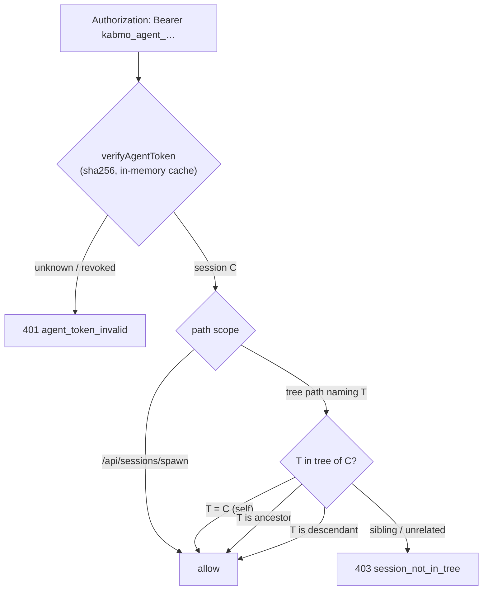
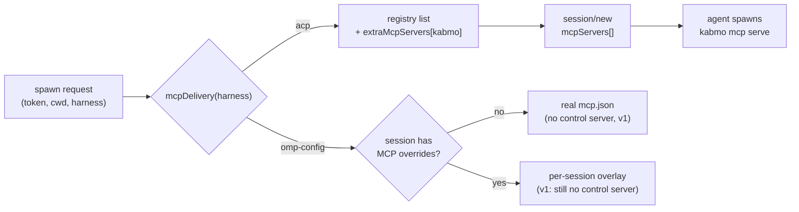
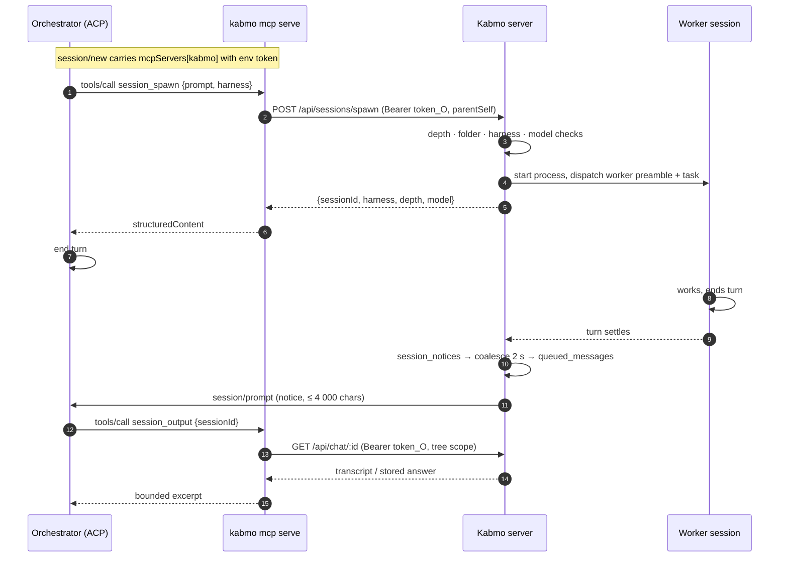

# M22 — The session MCP server: a typed control plane over the session tree

Status: **partial** — M22-0 shipped (tree-scoped agent tokens, async gate, peer token
fallback); the MCP server, its injection and the adapter matrix remain.

Terminology in this document: **configured MCP servers** are the external servers a session receives
(`mcp.json`, Settings, ACP `mcpServers`). The **control MCP server** is Kabmo's own server — the
subject here — and is one entry in that list.

---

## 1. The question

M20 established the control plane as CLI-first (`kabmo session spawn|tell|output|relations|wait`) and
MCP-second, because a shell command works for every harness while a tool call only works for agents
that prefer tools. The open question is narrower than "build an MCP server":

> What must the session layer expose to make orchestration a *typed tool call* instead of a shell
> command, without creating a second API, a second authorization model, or a second completion path?

The answer has three parts: an adapter (one binary, no new logic), a fixed authorization rule (the
tree the token belongs to), and a hard boundary (MCP cannot push a turn).

---

## 2. What exists today, measured in this tree

| Fact | Evidence |
|---|---|
| CLI verbs: `spawn`, `fork`, `tell`, `relations`, `output`, `wait` | `src/cli/lib/commands/session.js:8-13` |
| Every verb is an HTTP call with `KABMO_AGENT_TOKEN`; no direct DB access | same file, `call()` at `:66` |
| Spawn service enforces depth, folder match, harness, model, preamble | `src/server/lib/sessions/spawn.server.ts`; `MAX_SESSION_DEPTH = 4` in `relation-types.ts:12` |
| The worker preamble names `kabmo session output` and `kabmo session tell <coordinator>` | `spawn.server.ts` → `dispatchedWorkerPrompt` |
| Agent token: `kabmo_agent_<uuid>`, sha256 in `session_agent_tokens` | `src/server/lib/sessions/agent-token.server.ts`; table in `src/server/lib/sessions/schema.server.ts:60-65` |
| Injected env for a child: `KABMO_AGENT_TOKEN`, `KABMO_SERVER_URL` only | `agentEnvironment()`, same file |
| `KABMO_SESSION_ID` and `KABMO_RUN_ID` are documented (M19 §5.2, M20 §8.3) but **never written** | `rg KABMO_SESSION_ID src` → no match outside docs |
| Token → path scope: `/api/sessions/spawn` = any; `/api/agent/:id`, `/api/chat/:id`, `/api/sessions/:id/{fork,relations,answer}` = **that exact id** | `agent-token.server.ts:110-116` |
| The gate applies that scope only when UI auth is ON | `src/server/lib/auth/guard.ts:317-324`; `guard.ts:305` returns early when `!active` |
| Last assistant text is stored per session, so `output` survives a dead ACP process | `src/server/lib/sessions/answers.server.ts`; `session_answers` table |
| Child outcomes coalesce 2 s → one `queued_messages` row; excerpt capped at 4 000 chars | `src/server/lib/sessions/notify.server.ts` (`NOTICE_WINDOW_MS`, `OUTPUT_EXCERPT_LIMIT`) |
| ACP accepts `mcpServers` per session; stdio/http/sse shapes are typed | `src/server/lib/harness/acp/protocol.ts:142-170`; `session-new` call site `src/server/lib/harness/spawn.server.ts:131-139` |
| `omp-rpc` gets MCP through a per-session agent-dir overlay, built **only when the session has overrides** | `src/server/lib/mcp/session-overlay.server.ts:79-88`; `src/server/lib/omp/rpc/spawn-mcp.ts:30-43` |
| Delivery is per harness, exhaustively tabled | `src/shared/lib/harness/mcp-facts.ts` |
| Kabmo can already *speak* MCP as a client, newline-delimited JSON-RPC, protocol `2025-06-18` | `src/server/lib/omp/config/mcp-test.ts`; `mcp-test-protocol.ts:16` |
| No MCP server implementation and no `@modelcontextprotocol/sdk` dependency | `package.json`; no `modelcontextprotocol` import in `src` |

### 2.1 The blocking finding: the control plane does not work with UI auth on

The scope predicate returns the id *named in the path*. The gate then requires the bearer token's
session to equal it. Two consequences, both fatal to the shipped contract:

1. An orchestrator (`C`) cannot read a child: `kabmo session output W` → `GET /api/chat/W` → scope
   `W` ≠ token `C` → 401.
2. A worker (`W`) cannot tell its coordinator: the preamble instructs `kabmo session tell C` →
   `POST /api/agent/C` → scope `C` ≠ token `W` → 401.

Neither direction has a relation-aware exception, and the gate returns before the token check when
auth is disabled (`guard.ts:305`). So M20 §8.9's three-worker run — which did read every child's
output through the CLI — can only have run with authentication off. `[INFERENCE]` on that run's
flags; the scope predicate is read directly and admits no other path.

This is not an MCP problem; the CLI has it today. But an MCP tool that wrapped these routes would
inherit it and look broken for reasons no tool description could explain. **Fix the rule before
building the adapter.**

**Fixed in M22-0** (§4.12): the scope is now a tree, the gate is async, and the live-server
measurement in §4.12.7 shows both directions answering 200 with a password armed.

---

## 3. What MCP changes, and what it cannot

MCP gives an agent a typed, discoverable tool with a JSON schema, a stable error shape, and an
`instructions` string delivered at `initialize`. That is genuinely better than a shell for models
trained on tool calls: no quoting, no heredocs, no `--prompt-file -` (M20 §8.9 records the parser bug
that made exactly that form fail once).

MCP does **not** give a server-initiated turn. Tools are request/response; `notifications/*` are
process-level signals, not prompts, and no agent turns a notification into a user-visible message.
So the completion contract stays where M20 put it: the child's turn settles, Kabmo coalesces the
outcome into `queued_messages`, and the dispatcher prompts the parent. The MCP server therefore adds
**no** delivery path — a design constraint, not an omission.

Corollary: `session_wait` must not be a tool. M20 D14 bans blocking waits in the agent loop; a tool
that polls inside the agent's turn is the same defect with a nicer interface. `wait` stays CLI-only
for scripted use.

---

## 4. Design

### 4.1 Transport: stdio first, HTTP only when a harness forces it

Two legal transports, and the choice is a property of the adapter matrix, not taste.

| | stdio (`kabmo mcp serve`) | Streamable HTTP (`/api/mcp`) |
|---|---|---|
| Adapter support | ACP baseline: every ACP agent must support stdio MCP | requires advertised `mcpCapabilities.http`; measured today only for `grok` (`mcp-facts.ts`) |
| Identity | token in the spawned child's env, passed by the injector | token in an `Authorization` header |
| New auth surface | none — the child is local | must validate `Origin`, bind loopback, mint/validate `Mcp-Session-Id`, honour `MCP-Protocol-Version` |
| Process cost | one Bun child per agent that receives it | none |
| PATH dependency | none if launched as `<bun> <cli entry>` (see 4.6) | none |

**Decision M22-D1 — stdio is P0; HTTP is not built speculatively.** The stdio path is testable and
portable across the whole catalog. `/api/mcp` is written only when a harness in
`HARNESS_MCP_FACTS` is measured to need it, because the spec-compliant HTTP server is a second
protocol surface (session ids, resumability, Origin validation) that no current requirement pays for.

### 4.2 Identity comes from the process, never from a tool argument

The server reads `KABMO_AGENT_TOKEN` and `KABMO_SERVER_URL` at startup. No tool takes a token, a
server URL, or `parentSessionId`. If either variable is missing, the process exits non-zero with
`agent_token_missing` on stderr: a control server with no identity is worse than no server, because
an agent would still try.

`session_spawn` is always `parentSelf`. An agent cannot name an arbitrary parent, mirroring
`spawn.ts:71` (`parentSelf requires an agent token`).

### 4.3 Authorization: the token's tree, not one id

**Decision M22-D2 — a token may act on itself, its ancestors and its descendants.** Not siblings; a
fork has no parent edge, so it stays separate. Rationale: the two verbs the contract already relies
on are child→parent (`tell` the coordinator) and parent→child (`output`, `tell` the worker). The
depth cap is 4, so the connected set is small and bounded. Cross-run isolation survives: two
orchestrators in one folder cannot address each other.

Implementation shape (boring, one place):

- `agentTokenScopeForPath` returns a scope *kind* — `'any' | 'self' | 'tree'` — not an id.
- The gate resolves `verifyAgentToken` (sync, cached) to the caller's session, then, for `'tree'`,
  asks a relation helper whether the target id is the caller, an ancestor, or a descendant. The gate
  becomes async; Elysia's `onBeforeHandle` already supports that.
- `/api/sessions/spawn` stays `'any'`; every other agent path becomes `'tree'`.

Rejected alternative: keep per-path ids and add a bypass for MCP. That is a second authorization
model and it diverges the moment a route is added. Rejected too: no check at all inside the MCP
server — the server calls HTTP with the agent's token on purpose, so the CLI, the MCP tools and the
UI all exercise the same rule.

Tests: child→parent `tell` allowed; parent→child `output` allowed; sibling denied; unrelated session
denied; a session deleted mid-walk answers `session_not_found`, not 500. The exact code, SQL and
rollout are in §4.12.

### 4.4 The tool set

Four tools, named for the session they act on. No verb that the CLI cannot express, no "run" tool —
a Run is a namespace (M20 D10), not a resource an agent should create.

```jsonc
session_spawn   // { prompt, harness?, model?, thinkingLevel?, cwd? }
                // → { sessionId, harness, depth, model: {provider,modelId}|null }
session_tell    // { sessionId, message }
                // → { ok: true, sessionId, delivered: "prompt" }
session_output  // { sessionId, chars?: 4000, tail?: true }
                // → { sessionId, running, answer, truncated }
session_status  // { sessionId }
                // → { sessionId, running, harness, cwd, model, depth, queued }
```

- `session_output` is bounded and defaults to the notice's 4 000-char excerpt
  (`notify.server.ts`), because the reader is a model paying for every token, and a transcript can be
  megabytes. `tail: true` (default) keeps the end, which is the answer.
- `session_status` projects `/api/agent/:id` (`getAgentState`, `src/server/routes/agent/command.ts:316`).
  No new route.
- `session_tell` maps to the existing `POST /api/agent/:id` (`{type:'prompt', message}`). It exposes
  **no** `mode` argument: the route has no steer verb, and delivery is the queue's decision
  (`queue/delivery.server.ts`). A tool knob that the server ignores would be a lie the model plans
  around.

`session_relations` is deliberately absent in v1: it is a UI-shaped read, and `session_status`
answers the question a coordinator actually asks. Add it when a measured run needs the tree shape.

### 4.5 Results and refusals

Every successful call returns one `text` content item carrying compact JSON plus
`structuredContent` (spec 2025-06-18). Every refusal returns `isError: true` with
`{"code": "...", "message": "..."}` and **no** fabricated result:

| Code | Cause |
|---|---|
| `agent_token_missing` / `agent_token_invalid` | startup, or the token was revoked while running |
| `session_not_found` | unknown or purged id |
| `session_not_in_tree` | the target is outside self/ancestors/descendants |
| `harness_unavailable` | the catalog knows it, this machine cannot launch it (M22 uses `spawn.server`'s typed refusal) |
| `model_unknown` | the harness does not list the requested model |
| `depth_exceeded` | spawn would cross `MAX_SESSION_DEPTH` |
| `folder_mismatch` | child cwd resolves to a different workspace folder |
| `output_unreadable` | no stored answer and no readable transcript (ACP process gone) |
| `server_unreachable` | `KABMO_SERVER_URL` cannot be reached; names both loopback spellings tried |

Mapping from `SessionSpawnError.code` is one table, so a new spawn refusal cannot silently become a
generic 500. Unknown tool → JSON-RPC `-32602`; unknown method → `-32601`; a thrown handler bug →
`-32603` with the message on stderr as well.

### 4.6 Launching the binary

Do not rely on `kabmo` being on the agent's `PATH`: a shell-substituted install, a version-manager
shim, and a GUI-launched server produce three different `PATH`s, and the failure is
`spawn ENOENT` inside the agent. The injector launches the CLI through the running runtime and the
known entry path:

```
<bun executable> <pkgRoot>/src/cli/kabmo.js mcp serve
```

with `cwd` = the session's cwd and `env` = `{KABMO_SERVER_URL, KABMO_AGENT_TOKEN}`. The same
injector table decides whether a harness gets it at all.

### 4.7 Injection

| Harness delivery | What changes | Notes |
|---|---|---|
| ACP (`mcp-facts.ts` `acp`) | `AcpSpawnRequest` gains `extraMcpServers`; `openAcpSession` appends it to the registry-derived list | The token is already in `request.env` at that point (`spawn.server.ts`), so the entry's `env` list is explicit and per-session |
| `omp-rpc` (`omp-config`) | out of scope for v1 | The overlay is built only when the session has overrides (`session-overlay.server.ts:87`), and `mcp.json` is a shared surface; injecting a per-session token requires always building the overlay and threading the token into `sessionMcpSpawn`. omp already has the CLI, so this buys the least of any harness |

The ACP entry:

```jsonc
{ "name": "kabmo", "command": "<bun>", "args": ["<pkgRoot>/src/cli/kabmo.js", "mcp", "serve"],
  "env": [ {"name":"KABMO_SERVER_URL","value":"..."},
           {"name":"KABMO_AGENT_TOKEN","value":"kabmo_agent_..."} ] }
```

Enablement is not the same question as delivery. Injecting into every chat gives every top-level
session delegation (M19's intent) at the cost of one child process each; injecting only into
children and Run members keeps the cost proportional. **Recommendation:** a setting
`orchestration.controlServer: "off" | "runs" | "all"`, default `"runs"`, read at spawn. `[INFERENCE]`
on the process cost — measure before choosing the default.

**Trust note, stated in the code:** the token is already in the agent's environment. The MCP server
is not a privilege boundary and must not be presented as one; it is a typed facade over the same
credential the shell already holds. M20 §8.3 says the same about the token itself.

### 4.8 `instructions` is where the orchestrator contract lives

`InitializeResult.instructions` is the only string an agent receives before its first prompt. For an
ACP session the server is connected at `session/new`, so the text arrives before the user's goal.
It survives a resume, and it does not pollute the transcript the way M20 §8.5's first-prompt block
does.

Content: when to delegate, the four tool names, "a worker sees nothing of this conversation", "start
independent workers in the same turn", "end your turn — the outcome arrives as a message", "do not
poll", and the depth cap. Keep it under ~15 lines; it competes with the agent's own prompt.

This does not replace the first-prompt contract block for CLI-only sessions. `[INFERENCE]` that each
adapter forwards `instructions` to its model; measure on `claude`, `codex`, `omp-acp` before claiming
it.

### 4.9 stdout is the protocol

The CLI's `log()`/`ok()` write to stdout. In `mcp serve` every diagnostic goes to stderr, and a test
asserts that **every** stdout line parses as a JSON-RPC object. One stray banner corrupts the
session and the agent reports "MCP server failed to start" with no clue why.

Implementation notes: reuse `readLines` (`src/server/lib/omp/rpc/lines.ts`) for stdin; `JSON.stringify`
never emits a raw newline, so framing is one object per line; implement `initialize`,
`notifications/initialized`, `ping`, `tools/list`, `tools/call`; negotiate by answering with
`2025-06-18` when the client's version is unknown.

### 4.10 The shape, in one picture

```text
┌────────────────────────────── Kabmo server (Bun / Elysia) ───────────────────────────────┐
│ routes    /api/sessions/spawn · /api/agent/:id · /api/chat/:id · /api/sessions/:id/…     │
│ gate      bearer → session → tree scope (self ∪ ancestors ∪ descendants)                 │
│ services  spawn.server · notify.server · queue/delivery · answers.server                 │
│ SQLite    session_relations · session_agent_tokens · session_answers · queued_messages   │
└───────────────────┬───────────────────────────────────────────────┬──────────────────────┘
    ┌───────────────┴───────────────┐               ┌───────────────┴───────────────┐
    │ kabmo CLI (shell)             │               │ kabmo mcp serve               │
    └───────────────┬───────────────┘               └───────────────┬───────────────┘
                    │                                               │
                    │ shell tool                                    │ tools/call
┌───────────────────┴───────────────────────────────────────────────┴──────────────────────┐
│ Orchestrator agent — Claude ACP · omp RPC · codex · …                                    │
└─────────────────────────────────────────────┬────────────────────────────────────────────┘
                                              │
                                              ▼ server-spawned, own token
┌─────────────────────────────────────────────┴────────────────────────────────────────────┐
│ Worker sessions — own process, own token, own cwd / worktree                             │
└──────────────────────────────────────────────────────────────────────────────────────────┘
```

The tree the token rule walks:

```text
                 C   orchestrator, token_C
               / | \
             W1 W2 W3   workers, token_W1..3
             |
             H1        helper, depth 3

token_C  may act on  C, W1, W2, W3, H1     self + descendants
token_W1 may act on  W1, H1, C             self + descendants + ancestors
token_W1 may NOT act on  W2, W3            siblings
```







### 4.11 The MCP path, command for command

Today the orchestrator's whole control surface is a shell command. The MCP path is the same four
operations with a schema, and it is deliberately **not** a wrapper around the CLI: a tool that shells
out to `kabmo session …` gets human text back, pays a second process, and would have to parse its own
output to build `structuredContent`. The tool calls the HTTP route directly, with the same bearer.

| Today (CLI) | MCP tool | Wire call the tool makes |
|---|---|---|
| `kabmo session spawn --parent-self --harness <id> --prompt-file -` | `session_spawn` | `POST /api/sessions/spawn` `{prompt, harness, parentSelf:true}` → `201 {sessionId, harness, parentSessionId, depth, model}` |
| `kabmo session tell <id> --message-file -` | `session_tell` | `POST /api/agent/:id` `{type:"prompt", message}` |
| `kabmo session output <id> --json` | `session_output` | `GET /api/chat/:id`, then `GET /api/sessions/:id/answer` when the transcript is gone |
| `kabmo session wait <id>` (polls `GET /api/agent/:id`) | `session_status` | `GET /api/agent/:id` → projected to `{running, …}` |
| `kabmo session relations <id>` | — | CLI only in v1 |
| `kabmo session fork <id>` | — | CLI only in v1 |

`session_status` is the one tool with no dedicated CLI verb: `wait` reads the same route and throws
the rest away. That is the gap the tool closes, not a new capability.

#### The wire, as the agent sees it

```jsonc
// → client
{"jsonrpc":"2.0","id":1,"method":"initialize","params":{
  "protocolVersion":"2025-06-18","capabilities":{},
  "clientInfo":{"name":"claude-code","version":"…"}}}

// ← server
{"jsonrpc":"2.0","id":1,"result":{
  "protocolVersion":"2025-06-18",
  "capabilities":{"tools":{"listChanged":false}},
  "serverInfo":{"name":"kabmo","version":"0.x"},
  "instructions":"You can start and steer other Kabmo sessions. A worker sees nothing of this conversation. Use session_spawn for independent work, all in one turn; put the goal, paths, constraints and report format in `prompt`. Then END YOUR TURN: the worker's outcome arrives as a message. Do not poll. Read a worker's answer with session_output, ask or redirect with session_tell. Do not delegate what one tool call can answer. Nesting is capped at depth 4."}}

// → client
{"jsonrpc":"2.0","method":"notifications/initialized"}

// → client
{"jsonrpc":"2.0","id":2,"method":"tools/call","params":{
  "name":"session_spawn",
  "arguments":{"prompt":"Implement the billing split in src/billing. Run bun test. Report files changed.","harness":"omp-rpc"}}}

// ← server
{"jsonrpc":"2.0","id":2,"result":{
  "content":[{"type":"text","text":"{\"sessionId\":\"9f3c…\",\"harness\":\"omp-rpc\",\"depth\":1,\"model\":{\"provider\":\"aihub\",\"modelId\":\"deepseek-v4.1-flash\"}}"}],
  "structuredContent":{"sessionId":"9f3c…","harness":"omp-rpc","depth":1,"model":{"provider":"aihub","modelId":"deepseek-v4.1-flash"}},
  "isError":false}}
```

The orchestrator then ends its turn. The worker's outcome does **not** arrive as an MCP message — it
arrives as an ordinary prompt on the orchestrator's own session, rendered by `notify.server.ts`:

```text
Child session "Billing split" (9f3c…) completed:

Implemented the split in src/billing/{api,ui}.ts. bun test: 42 pass. Remaining: the
legacy adapter still imports the old module.
```

The next tool call reads the full answer, bounded:

```jsonc
// → client
{"jsonrpc":"2.0","id":3,"method":"tools/call","params":{
  "name":"session_output","arguments":{"sessionId":"9f3c…","chars":4000}}}

// ← server
{"jsonrpc":"2.0","id":3,"result":{
  "content":[{"type":"text","text":"Implemented the split in src/billing/{api,ui}.ts. …"}],
  "structuredContent":{"sessionId":"9f3c…","running":false,"answer":"Implemented the split …","truncated":false},
  "isError":false}}
```

A refusal is a result, not a transport error, so the model can act on the code:

```jsonc
{"jsonrpc":"2.0","id":4,"result":{
  "content":[{"type":"text","text":"{\"code\":\"session_not_in_tree\",\"message\":\"Session 7a11… is not in this session's tree\"}"}],
  "isError":true}}
```

#### Where each piece lives

None of these modules exist yet; this is the allocation, and each stays under the 350-line ceiling.

| Concern | Module |
|---|---|
| CLI entry, `serve` subcommand, missing-env exit | `src/cli/lib/commands/mcp.js`; `'mcp'` added to `COMMANDS` (`src/cli/main.js:19`) |
| stdio framing, `initialize` / `ping` / `tools/list` / `tools/call`, stdout discipline | `src/server/lib/mcp/control/protocol.server.ts` |
| the four schemas and their handlers | `src/server/lib/mcp/control/tools.server.ts` |
| HTTP call: bearer, timeout, loopback fallback | `src/server/lib/mcp/control/client.server.ts` (the fallback moves out of `session.js:98-110`, one copy) |
| `instructions` text, shared with the first-prompt contract block | `src/shared/lib/sessions/contract.ts` |
| excerpt, shared with the notice and the CLI's `output` | `src/shared/lib/sessions/excerpt.ts` |
| ACP entry construction | `src/server/lib/mcp/control/inject.server.ts` + `AcpSpawnRequest.extraMcpServers` |
| tree scope | `agent-token.server.ts` (scope kinds), `auth/guard.ts` (async), `sessions/relation-access.server.ts` (walk) |

#### What must be true before this path works

1. **M22-0.** With UI auth on, `session_output` and `session_tell` answer 401 today, because the token
   scope is the id in the path (`agent-token.server.ts:110-116`, `guard.ts:317-324`). The MCP path
   inherits that rule by design, so the rule is fixed first.
2. **Spawn stays self-only.** The route already refuses an agent token naming another parent
   (`spawn.ts:78-90`), so `session_spawn` cannot be used to attach a worker to someone else's tree.
3. **The binary is launched, not found.** `<bun> <pkgRoot>/src/cli/kabmo.js mcp serve`, with the
   token in `env` — no `PATH` dependency (§4.6).

#### What the CLI keeps

`wait` (scripted loops), `fork`, `relations`, `--json` for humans and CI, and every operation on a
machine where the agent has a shell but no MCP client. The MCP server is a second *surface* over one
API, not a replacement for the command.

### 4.12 M22-0, the prerequisite, concretely

The rule, in one table:

| Caller | Target | Allowed |
|---|---|---|
| `C` | `C` | yes — self |
| `C` | child, grandchild | yes — descendant |
| `W` | parent, grandparent | yes — ancestor |
| `W` | sibling | **no** |
| `W` | a fork of `W` | **no** — a fork has a source edge, not a parent edge |
| any | unrelated session | **no** |

#### 1. Scope becomes a kind, not an id

`src/server/lib/sessions/agent-token.server.ts`:

```ts
export type AgentPathScope =
  | { kind: 'any' }
  | { kind: 'tree'; target: string };

export function agentTokenScopeForPath(pathname: string): AgentPathScope | null {
  if (pathname === '/api/sessions/spawn') return { kind: 'any' };
  const direct = /^\/api\/(?:agent|chat)\/([^/]+)$/.exec(pathname);
  if (direct?.[1]) return { kind: 'tree', target: direct[1] };
  const sub = /^\/api\/sessions\/([^/]+)\/(?:fork|relations|answer)$/.exec(pathname);
  return sub?.[1] ? { kind: 'tree', target: sub[1] } : null;
}
```

#### 2. One module answers "is this target in my tree"

New: `src/server/lib/sessions/relation-access.server.ts`.

```ts
export type AgentAccess = 'self' | 'ancestor' | 'descendant' | null;

export async function resolveAgentAccess(caller: string, target: string): Promise<AgentAccess> {
  if (caller === target) return 'self';
  const db = await getDb();

  const down = await db.get(
    `WITH RECURSIVE down(id, depth) AS (
       SELECT session_id, 0 FROM session_relations WHERE session_id = ?
       UNION ALL
       SELECT r.session_id, down.depth + 1
         FROM session_relations r JOIN down ON r.parent_session_id = down.id
        WHERE down.depth < 8
     ) SELECT 1 AS hit FROM down WHERE id = ? LIMIT 1`,
    [caller, target],
  );
  if (down) return 'descendant';

  const up = await db.get(
    `WITH RECURSIVE up(id, depth) AS (
       SELECT parent_session_id, 1 FROM session_relations WHERE session_id = ?
       UNION ALL
       SELECT r.parent_session_id, up.depth + 1
         FROM session_relations r JOIN up ON r.session_id = up.id
        WHERE up.depth < 8
     ) SELECT 1 AS hit FROM up WHERE id = ? LIMIT 1`,
    [caller, target],
  );
  return up ? 'ancestor' : null;
}
```

- The ancestor walk starts at the **caller's** parent and looks for the target. Starting at the
  target's parent answers the descendant question a second time — the first draft of this query did
  exactly that, and the in-memory test below caught it.
- The depth guard is 8, not 4: 4 is the policy (`MAX_SESSION_DEPTH`), 8 is the loop guard for a
  corrupt row. A policy check inside a recursive CTE would turn bad data into a hang.
- Both queries use the primary key and `idx_session_relations_parent`; the tree is at most four
  levels, so this is two indexed lookups, not a scan.
- A session with no relation row is self-only. A fork row has `parent_session_id = NULL` and a
  `source_session_id`, so it never appears in either walk — the table above is the schema, not a
  special case in the query.
- Verified against an in-memory SQLite with the real column shape: self, child, grandchild, parent,
  grandparent, sibling, fork, unknown id, and a deliberately cyclic row (terminates, 0.0 ms).

#### 3. The gate becomes async and answers a typed 403

`src/server/lib/auth/guard.ts`:

```ts
export async function authGate(request: Request, clientAddress?: string): Promise<Response | undefined> {
  // … unchanged: OPTIONS, login redirect, public paths, `if (!active) return undefined`,
  //   cookie, device token …

  const scope = agentTokenScopeForPath(pathname);
  if (scope) {
    const caller = verifyAgentToken(bearerToken(request));
    if (caller) {
      if (scope.kind === 'any') return undefined;
      if (await resolveAgentAccess(caller, scope.target)) return undefined;
      return new Response(
        JSON.stringify({ error: 'That session is not in this session’s tree', code: 'session_not_in_tree' }),
        { status: 403, headers: { 'content-type': 'application/json; charset=utf-8', 'cache-control': 'no-store' } },
      );
    }
  }

  // … unchanged: device token, rejectionResponse …
}
```

Two properties are deliberate:

- **The 403 is identical for "exists but out of tree" and "does not exist".** The gate must not
  become an id oracle. Routes keep their own 404 for callers that already passed the tree check.
- **The gate still never reads the body.** The measured Elysia trap at `src/server/index.ts:120-136`
  is about touching the context, not about awaiting; the gate only awaits a DB read.

Call site: `onBeforeHandle` already returns the hook's value, so returning a promise is the whole
change (`src/server/index.ts:137`).

#### 4. Which paths

| Path | Scope |
|---|---|
| `/api/sessions/spawn` | `any` |
| `/api/agent/:id` — GET state, POST prompt | `tree` |
| `/api/chat/:id` | `tree` |
| `/api/sessions/:id/{fork,relations,answer}` | `tree` |
| everything else | `null` — an agent token is never accepted |

#### 5. Tests

- `relation-access.server.test.ts` (new): self; parent→child; child→parent; grandparent→grandchild;
  sibling `null`; unrelated `null`; fork-of-child `null`; session with no row `null`; a cycle in the
  data terminates instead of hanging.
- `agent-token.server.test.ts`: the scope shapes replace the string assertions at `:55-62`.
- `agent-tree-gate.test.ts` (new): the gate with a password armed — parent token on
  `/api/chat/child` passes; child token on `/api/agent/parent` passes; sibling answers
  `403 session_not_in_tree`; an unknown id answers the same body; no token answers 401; an agent
  token on `/api/settings` answers 401; a token absent from the cache is accepted from the table.
- Acceptance: a temp server started with `--ui-password`, one orchestrator and one worker, then
  `kabmo session output <worker>` and `kabmo session tell <parent>` both succeed. This was the exact
  case that failed before M22-0; the live-server measurement in §7 is its assembled-product proof.

#### 6. Known limits, stated rather than hidden

- **Peer relay — fixed.** `forwardToPeer` copies headers (`peer-proxy.server.ts:81`), so the token
  reaches the owning instance; `lookupAgentToken` now falls back to one indexed read and warms the
  cache, so a token minted after the peer booted is accepted. Covered by
  `agent-token.server.test.ts` ("a token this process never minted is found in the table") and by
  the live-server smoke test, which inserted the tokens directly so the cache was cold.
- **Archived sessions stay in the tree**, matching M19: archive is restorable, delete is not.
- **A fork is not addressable by its source's parent.** If that is ever wanted it is a new edge, not
  a widening of this rule.

#### 7. Rollout

**Shipped (M22-0).** No schema change and no migration. What landed:

| Change | File |
|---|---|
| scope is a kind (`any` / `tree`) | `src/server/lib/sessions/agent-token.server.ts` |
| `lookupAgentToken` — cache, then one indexed read, then warm the cache | same file |
| the tree walk, two bounded recursive CTEs | `src/server/lib/sessions/relation-access.server.ts` |
| the agent half of the gate, three outcomes | `src/server/lib/auth/agent-gate.server.ts` |
| async gate, typed 403 | `src/server/lib/auth/guard.ts` |
| tests: tree walk, token fallback, gate with a password armed | `relation-access.server.test.ts`, `agent-token.server.test.ts`, `agent-tree-gate.test.ts`, `guard.test.ts`, `handover-guard.test.ts` |

Measured on a live server started with `KABMO_UI_PASSWORD` and a temp database, tokens inserted
directly so the process's cache was cold (the peer case):

| Request | Before | After |
|---|---|---|
| parent token → `GET /api/chat/<child>` | 401 | **200** |
| child token → `GET /api/agent/<parent>` | 401 | **200** |
| worker token → `GET /api/chat/<sibling>` | 401 | **403 `session_not_in_tree`** |
| worker token → `GET /api/chat/<unknown>` | 401 | **403, same body** |
| no token → `GET /api/chat/<child>` | 401 | 401 |
| agent token → `GET /api/settings` | 401 | 401 |
| agent token → `POST /api/sessions/spawn` | 400 (prompt required) | 400 (prompt required) |

Gates: `bun run lint`, `bunx tsc --noEmit --noUnusedLocals --noUnusedParameters`, `bun test`.

---

## 5. Alternatives rejected

| Alternative | Why not |
|---|---|
| A Go/Rust sidecar like `orca mcp serve` | Kabmo's contract is "one API, one auth rule"; a second implementation of the session semantics drifts |
| A second HTTP API under `/mcp` that talks to services directly | Both surfaces must enforce the same tree rule; routing through the agent-token HTTP contract makes that structural |
| MCP tools that call the DB | Bypasses the token, the queue, and the peer bridge; untestable against the real product |
| Server-initiated turns via MCP notifications | Agents do not turn notifications into turns; the queue is the only honest push path |
| `session_wait` as a tool | Violates M20 D14; blocks the agent's turn on a preemptable condition |
| Unbounded `session_output` | Token cost and a real risk of filling the context with a transcript the agent will not read |

---

## 6. Phases

| Phase | Delivers | Proven by |
|---|---|---|
| **M22-0** | tree-scoped agent token (`self`/`tree`), async gate, relation walk; CLI works with `--ui-password` | child `tell` parent, parent `output` child, sibling denied, all with auth on |
| **M22-1** | `kabmo mcp serve`: stdio framing, four tools, typed refusals, `instructions`; no injection yet | a scripted stdio client (test) drives every tool against a temp server; every stdout line parses |
| **M22-2** | ACP injection through `extraMcpServers` + the control-server setting | a real Claude ACP session calls `session_spawn`, receives the worker notice, reads `session_output` — no shell |
| **M22-3** | adapter matrix recorded in `HARNESS_MCP_FACTS` notes: which adapters connect stdio, forward `instructions`, and honour `env` | measured on `claude`, `omp-acp`, `codex`, `grok` |
| **M22-4** | optional: omp-rpc overlay injection, `/api/mcp`, `session_relations`, Run-scoped enablement | only if a measured need exists |

Acceptance for M22-2 (the Q3 gate): an orchestrator on any ACP harness spawns an omp worker by tool
call, ends its turn, is woken by the coalesced notice, and reads the worker's bounded output — with
UI auth enabled.

---

## 7. Risks

- **The authorization widening is the real security change in this milestone.** Ancestors +
  descendants is broader than "self"; the tests in M22-0 are the contract, and a sibling denial is
  mandatory. A token still is not an admin credential.
- **The control server is not a boundary.** Same user, same DB, same token as the shell. Document it
  in the route/MCP doc comment, not in marketing.
- **One child per participating session.** A fan-out of eight workers plus eight MCP servers is
  sixteen processes. Cap and surface it with the Run limits (M20 Q4), not with hope.
- **Adapter tolerance is unmeasured.** ACP requires connecting the list, but stdio implementations
  differ; `instructions` forwarding is not guaranteed. M22-3 exists because this is `[INFERENCE]`.
- **Context blowup.** The default excerpt exists for this reason; an agent that needs more calls
  `session_output` with a larger `chars`, explicitly.
- **Duplicate advice: CLI and tools say the same thing.** The `instructions` text and the first-prompt
  contract must come from one module (`shared/lib/sessions/contract.ts`), or they will drift and the
  model will read two different sets of rules in one session.
- **A stray `console.log` breaks the transport.** Guarded by the stdout test, not by review.
- **Recursion.** A worker that can spawn workers is bounded by `MAX_SESSION_DEPTH` at spawn, already
  enforced in `spawn.server.ts`; MCP must not add a second cap.

---

## 8. Sources

| Source | Used for |
|---|---|
| [MCP transports, 2025-06-18](https://modelcontextprotocol.io/specification/2025-06-18/basic/transports) | stdio is newline-delimited JSON, stdout carries messages only; Streamable HTTP requires `Origin` validation and session ids |
| [MCP tools, 2025-06-18](https://modelcontextprotocol.io/specification/2025-06-18/server/tools) | `tools/list`, `tools/call`, `content`, `structuredContent`, `isError` |
| MCP lifecycle, 2025-06-18 | `InitializeResult.instructions` |
| M20 §8.3, §8.5, §9 Q3, §10 | env, prompt contract, the phase definition, the injection-trust risk |
| M19 §5.2, §5.4 | agent token intent ("read its subtree"), CLI shape, no universal system prompt |
| `src/server/lib/sessions/agent-token.server.ts`, `src/server/lib/auth/guard.ts` | the measured scope rule and the auth-off early return |
| `src/server/lib/sessions/spawn.server.ts`, `notify.server.ts`, `answers.server.ts` | spawn refusals, preamble, excerpt limit, stored answer |
| `src/server/lib/harness/acp/protocol.ts`, `src/server/lib/harness/spawn.server.ts`, `src/shared/lib/harness/mcp-facts.ts` | the injection seam and the delivery table |
| `src/server/lib/mcp/session-overlay.server.ts`, `src/server/lib/omp/rpc/spawn-mcp.ts` | why omp-rpc injection is a separate, larger change |
| `src/server/lib/omp/config/mcp-test.ts`, `mcp-test-protocol.ts` | Kabmo already speaks this protocol as a client, at `2025-06-18`, newline-delimited |
