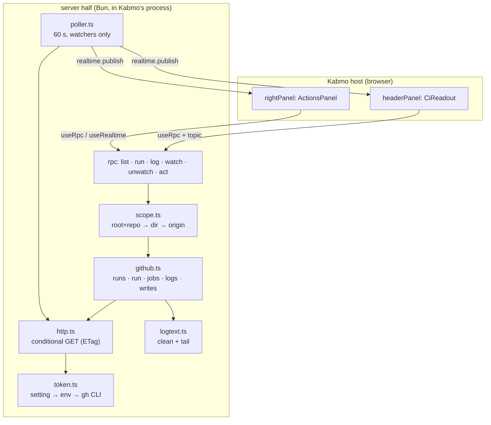
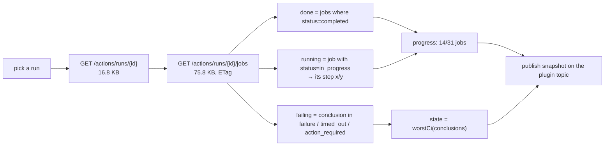
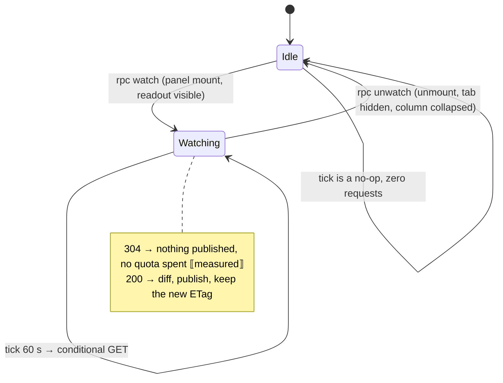
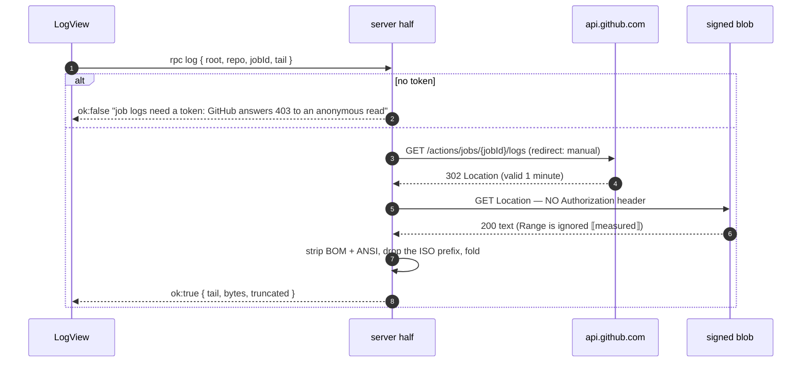
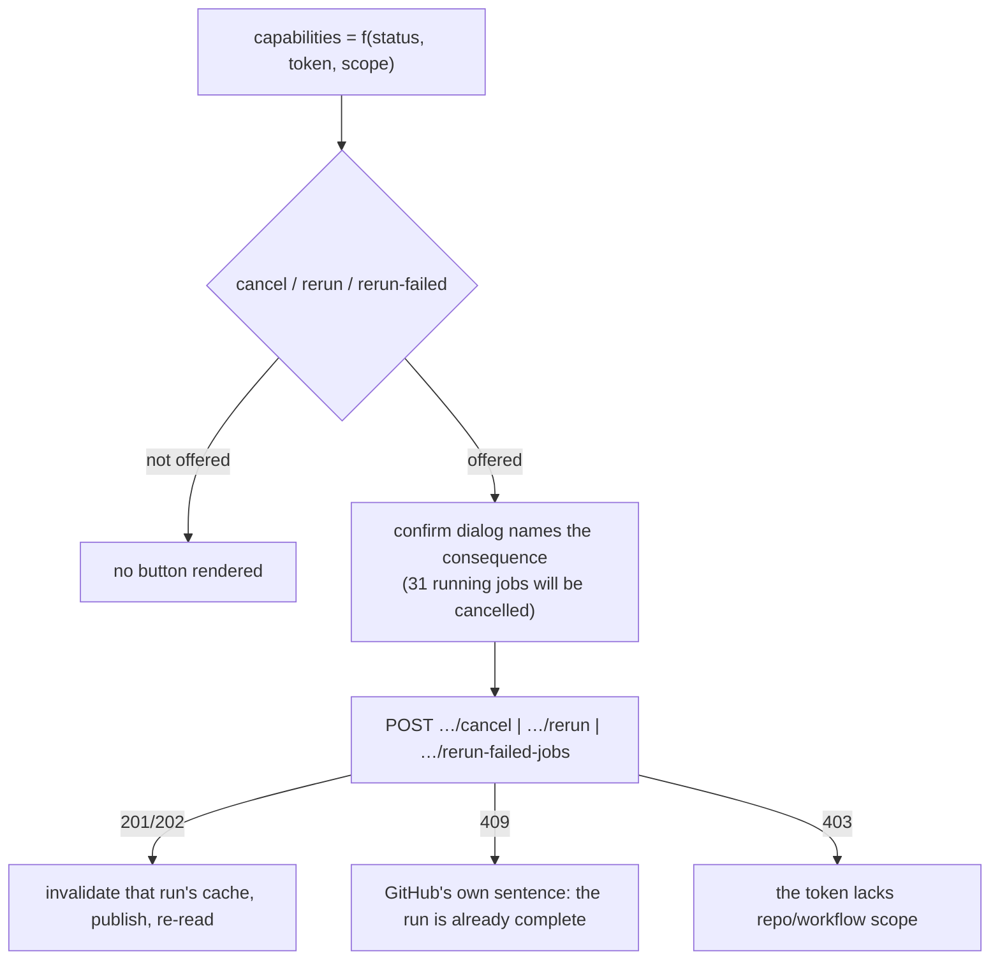

# M24 — GitHub Actions viewer: a panel plugin that monitors a repository's runs

Status: **partial** — the plugin shipped and is smoke-tested in a real browser (list, run drill, job
logs, the three verbs, header readout, 51 tests); the shared-core extraction (P0 / D1) and the
run-level log archive remain (2026-11-21).

The shipped code is `marketplace/plugins/github-actions/`; its README is the operator-facing contract,
and §13 records what the smoke run observed.

Every number marked ⟦measured⟧ was produced on this machine (macOS 27 / arm64, Bun 1.4.4, gh 2.104.0)
against `kabmo-labs/kabmo` with a token carrying `repo,workflow`; no number here is quoted from a
document without the same run reproducing it.

---

## 1. Identity

| | |
|---|---|
| Plugin id | `github-actions` |
| Plugin name | `Actions` |
| Panel title | `Runs` (the activity bar reads `Runs — Actions`) |
| Directory | `marketplace/plugins/github-actions/` |
| Visible surfaces | ONE `rightPanel` (the runs list → run → job → log drill) and ONE `headerPanel` (a failing-count readout that opens the panel) |
| Bundled store | installed from Settings → Plugins Kabmo like the four shipped plugins; a `marketplace.json` row is documentation only |
| Capabilities | `["server", "storage", "rpc", "realtime", "settings", "repo-scope"]` — every one of them is in `HOST_CAPABILITIES` today |
| Registration sizing | `minWidth: 420`; a run row carries state, title, branch, number, actor and age |

`rightPanel` and `headerPanel` are two SLOTS, so one plugin can hold both without a second manifest.

---

## 2. The question, and the answer in one paragraph

> Can Kabmo show what the repository in the current scope is doing on GitHub Actions — which runs
> exist, which are in flight, how far each has got, why the red one is red — without a second
> credential store, without a polling loop that burns the user's API quota, and without a second
> source of truth for the shared repo scope?

Yes, and the two constraints that decide the design are measured, not assumed: **conditional requests
are free** (a `304` left `x-ratelimit-remaining` unchanged across six polls ⟦measured⟧), and **the
log download redirect cannot carry the token** (forwarding `Authorization` to the signed blob URL
answers `401 InvalidAuthenticationInfo` ⟦measured⟧). The first makes polling legitimate; the second
makes the log path a two-request dance rather than a `fetch` with a header.

---

## 3. What exists today, measured in this tree

| Fact | Evidence |
|---|---|
| No Actions code anywhere | `rg -i 'actions/runs\|workflow_run\|check-runs'` hits only `git-forge/src/server/{ci.ts,github.ts}` |
| The only CI surface is a **detail-only badge** on a forge item | `git-forge/src/panel/CiBadge.tsx` — "no host puts a pipeline on a LIST response, so a row badge would cost one request per row" |
| The built-in git panel has no CI at all | `rg -i 'checks\|workflow' src/client/components/workspace/git-panel` → nothing; `src/server/lib/fs/**` → nothing |
| Built-in right-panel ids are closed to plugins | `RIGHT_PANEL_TYPES` (`src/shared/lib/workspace/right-panels.ts`), 12 ids, no extension point |
| A plugin panel is **unmounted** when it is not the active view (desktop) | `RightColumn.tsx`: `if (!panel.builtin && !isActiveView) return null` |
| A plugin `headerPanel` stays mounted, so a readout must gate on document visibility itself | `stats/src/HeaderReadout.tsx` (`useDocumentVisible` + `watch`/`unwatch`) |
| There is **no toast or OS-notification service** in the kit | `UiKitServices` (`packages/kabmo-ui/src/services.ts`) has no toast member; plugin `events.emit` reaches plugins and the client only |
| A plugin HTTP route is the real `Request` → `Response` pair, so it may stream | `src/server/routes/plugins/http.ts` |
| `background.schedule`'s floor is 1 minute, on a 15 s host tick | `PLUGIN_SCHEDULE_TICK_MS = 15_000`, `MIN_INTERVAL_MS = 60_000` |

Reusable foundation, **not importable across plugins** (see D1):

| Module | Lines | What it already solves |
|---|---|---|
| `git-forge/src/server/token.ts` | 229 | `resolveToken`: plugin setting → `GITHUB_TOKEN`/`GH_TOKEN` → `gh auth token --hostname <host>`, cached per host including failures |
| `git-forge/src/server/http.ts` | 329 | conditional GET (`ETag`/`If-None-Match`), `kvCache` over `api.storage.kv`, `describeFailure` for 401/403/404/429 with the reset hint |
| `git-forge/src/server/scope.ts` | 66 | `resolveScope` (absolute root + containment) and `readOrigin` |
| `git-forge/src/server/remote.ts` | 188 | `parseRemote`, `apiBaseFor` (github.com and a GHES `apiBase` override) |
| `git-forge/src/server/ci.ts` | 118 | one state vocabulary (`success/failure/pending/neutral`, unknown word → `neutral`) and `worstCi` |
| `packages/kabmo-ui/src/{repo.ts,repo-picker.tsx}` | 378 | `useRepoScope` over the slot the Files/Search/Git/Terminal panels share |

---

## 4. The API surface, measured

Run against `kabmo-labs/kabmo` (591 runs, 23 workflows at the time of the probe).

| Read | Result ⟦measured⟧ |
|---|---|
| `GET /actions/runs?per_page=30` | 481,427 B, `total_count: 591` |
| `…?per_page=100` | 1,595,896 B |
| `…?per_page=5` / `=10` | 80,747 B / 159,540 B |
| `…?per_page=101` | clamped to 100 rows, `200` |
| `GET /actions/runs/{id}` | 16,790 B — `html_url`, `logs_url`, `rerun_url`, `cancel_url`, `run_attempt`, `display_title`, `head_commit` |
| `GET /actions/runs/{id}/jobs?per_page=100&filter=latest` | 75,814 B, 31 jobs; each job carries `steps[]` (8–13 steps) with `number/name/status/conclusion/started_at/completed_at`, plus `runner_name`, `labels`, `html_url` |
| `GET /actions/runs/{id}/attempts/{n}/jobs` | the same 31 jobs for attempt 1 |
| `GET /actions/workflows?per_page=100` | 13,389 B, 23 workflows |
| `ETag` + `If-None-Match` on the runs list | `304`, and `x-ratelimit-remaining` stayed `4899` across six consecutive conditional polls |
| the same on `/jobs` and on `/workflows/{id}/runs` | `304`; remaining stayed `4863` and `4716` respectively |
| `x-poll-interval` | **absent**; `Cache-Control: private, max-age=60` |
| Anonymous `runs` / `jobs` / `artifacts` | `200` / `200` / `200` |
| Anonymous `GET /actions/jobs/{id}/logs` | **403** `"Must have admin rights to Repository."` |
| `GET /actions/jobs/{id}/logs` with a token | `302` → `productionresultssa18.blob.core.windows.net`, signed URL 506 B |
| `GET /actions/runs/{id}/logs` with a token | `302` → `results-receiver.actions.githubusercontent.com`, a **zip** |
| the signed URL **with** `Authorization` forwarded | `401 InvalidAuthenticationInfo` |
| the signed URL **without** auth | `200`, 17,049 B (a small job) / 63,430 B (an E2E shard) |
| `Range: bytes=-2000` on the signed URL | ignored — `200` with the full 63,430 B, although `Accept-Ranges: bytes` is advertised |
| run-level zip | 2,155,766 B, **179 entries**, 8,521,089 B inflated, largest entry 1,915,111 B; names `"<Workflow Job>/<n>_<step>.txt"` plus flat `"<n>_<job>.txt"` |
| reading that zip with no dependency | `Bun.inflateSync`, `node:zlib.inflateRawSync` and `DecompressionStream('deflate-raw')` each produced the identical 23,168 B for entry 1 |
| job log text | UTF-8 BOM (`EF BB BF`), per-line ISO timestamp prefix, `##[group]` / `##[warning]` markers, ANSI escapes present (4 lines in one 63 KB log) |
| `POST …/runs/{id}/cancel` on a **completed** run | `409` (docs: `202` accepted, `409` conflict) |
| `POST …/runs/{id}/rerun`, `…/rerun-failed-jobs` | `201` |
| `POST …/workflows/{id}/dispatches` with no body | `422` `"ref wasn't supplied"` — the route exists |
| GraphQL `statusCheckRollup` over 20 commits | 4,126 B, cost **1 point**; each `CheckRun` carries `databaseId` and `checkSuite.workflowRun.{databaseId,url,workflow.name}` |
| Conclusions actually present | `success, failure, cancelled, skipped` (the API also defines `neutral, timed_out, action_required, stale`) |
| Latency, this machine → `api.github.com` | runs list ~1.6 s; jobs 1.0–1.8 s |

Two consequences follow immediately:

- **The list is the expensive read.** 16 KB per run, because every row embeds a full `repository`
  object. `per_page=30` is the ceiling for a panel; `100` is 1.6 MB for a list nobody scrolls.
- **The log path is not a `fetch`.** `redirect: 'follow'` sends the token to a third-party host and
  the answer is `401`. The plugin must fetch with `redirect: 'manual'` and re-request `Location`
  without the header.

---

## 5. Architecture



`storage.kv` holds the ETag cache (one entry per URL, as `git-forge` already does), the last snapshot
per repo, and the per-workflow duration samples used for an ETA. `settings-schema.json` declares
`token` (secret), `apiBase`, `perPage`, `pollSeconds`, `monitor`, `logTailKb`.

### Flow A — read the list

```mermaid
sequenceDiagram
    autonumber
    participant P as ActionsPanel
    participant S as server half
    participant GH as api.github.com
    P->>S: rpc list { root, repo, filter }
    S->>S: resolveScope(root, repo) — refuse outside root
    S->>S: readOrigin(dir) — refuse with no origin
    S->>S: parseRemote(origin) → host, slug
    alt provider is not github
        S-->>P: ok:false "Actions needs GitHub; this remote is <host>"
    else
        S->>S: resolveToken(github, { setting, env, host })
        Note over S: no token is legal — runs and jobs read anonymously, logs do not
        S->>GH: GET /repos/{slug}/actions/runs?per_page=N[&branch][&status] (If-None-Match)
        GH-->>S: 200 body | 304 Not Modified
        S->>S: map rows → id, name, display_title, head_branch, event, status, conclusion, run_number/attempt, actor, created_at/run_started_at, html_url
        S-->>P: ok:true { runs, total, truncated, notes }
    end
```

`notes` carries the non-fatal sentences the forge panel already taught: an anonymous read, a section
that failed, a token that cannot write. An empty list and a refused read are different answers and are
drawn differently (`ForgeSectionData.failed` is the precedent).

### Flow B — progress of one run



There is **no percentage field in the API**. The honest presentation is `14/31 jobs`, plus `step 7/13`
for the job that is running. An ETA appears only after five completed runs of the same workflow (median
duration stored in `storage.kv`); before that the panel prints `—`.

### Flow C — watch, and why polling is allowed



The watcher count lives in the plugin's server half, exactly as `stats` counts its samplers. A tick
with no watchers does not call GitHub at all — which is the only reason a header readout is affordable.

### Flow D — logs



The run-level zip is an explicit second action (`?all=1`), not the default: 2.1 MB compressed, 8.5 MB
inflated, 179 entries for one 31-job run. It is read with `Bun.inflateSync` and capped before it reaches
a component.

### Flow E — writes



---

## 6. Progress per flow

Every flow below is built and was exercised by the smoke run in §13, except where the last column
says otherwise.

| Flow | Built | Where |
|---|---|---|
| A. Runs list | **done** | `list` RPC, `runOf`, empty/failed/truncated states, per-URL ETag cache (`kvCache`) |
| B. Run progress | **done** | `run` + `jobs` RPC, `progressOf`, step list, failing roll-up (`worstState`) |
| C. Watch / poll | **done** | server poller behind `watch`/`unwatch`, conditional reads, `plugin:github-actions` topic, visibility gate in the readout |
| D. Logs | **done** (job granularity) | `redirect: 'manual'` then a bare request, `cleanLog`, byte cap, tail, "Whole log" |
| E. Writes | **done** | capability gate by token + state, consequence confirmation, GitHub's own 409/403 sentence |
| F. Header readout | **done** | failing/running counts from the snapshot, `—` before the first answer, watch released while the tab is hidden |
| G. Shared plumbing | **copied, extraction owed** | its own `token.ts` / `http.ts` / `remote.ts` / `scope.ts` (~460 lines) — see D1 |
| H. Tests | **done** | 51 assertions over the vocabulary, progress, log text, the adapter and the assembled panel |

---

## 7. Decisions

**D1 — the shared plumbing is extracted, not copied — NOT taken in v1.** A plugin bundle cannot import
another plugin's source (`@/…` does not resolve in a server bundle, and the build links only
`@kabmo-labs/*`). This is the **second** consumer of the credential ladder and the conditional cache,
which is exactly the trigger the repo's "a fact is stated once" rule names. The plugin therefore ships
its own copies — `token.ts` 84 lines, `http.ts` 202, `remote.ts` 80, `scope.ts` 51 = **~417 lines, plus
a 63-line shared state table** — and this paragraph is the record that the duplication was chosen.

Why not now: `packages/kabmo-sdk` is typechecked by `typecheck:consumer` with `types: []`, and both
`Bun.spawnSync` and `node:path` fail there, so a `@kabmo-labs/kabmo-sdk/forge` subpath would have to
be a new published package (consumer excludes only what it does not include, and the link table is
`kabmoPackageDirs`) — a release-pipeline change on its own. Owed as **P0**: extract, publish, migrate
`git-forge`, and delete the copies here.

**D2 — GitHub only in v1.** Run, job, log and rerun are GitHub's vocabulary. GitLab/Gitea/Bitbucket
are refused **by name** (`provider !== 'github'` → a sentence naming the host), never drawn as an
empty list.

**D3 — logs always require a token.** Measured: an anonymous job-log read is `403 "Must have admin
rights"`. The log row says so; it does not render an empty pane.

**D4 — no webhook.** A webhook needs ingress and a secret; Kabmo is usually behind NAT. Conditional
polling costs nothing while nothing changes (measured), so it is the correct mechanism rather than a
compromise.

**D5 — progress is job counts, never an invented percentage.** ETA only from ≥5 historical runs of the
same workflow.

**D6 — every write is gated by a capability and confirmed by consequence.** `rerun-failed-jobs` is a
first-class verb (it is what a reader wants after a red run), not an alias of `rerun`.

---

## 8. File plan

The 350-line ceiling applies per file; the plugin's own sources use relative imports because the
bundle is its own package, while anything under `src/**` in the host stays on `@/…`.

```
marketplace/plugins/github-actions/
  package.json          kabmo: { id, name, version, app, server, icon, color, slots, capabilities }
  settings-schema.json  token(secret) · apiBase · perPage · pollSeconds · monitor · logTailKb
  icon.svg              Lucide geometry copied verbatim (the Glyph rule in the panel kit)
  README.md             the forge README's shape: surfaces, limits, what it does not do, tests
  src/protocol.ts       Run · Job · Step · Progress · LogTail · Filter · RPC
  src/state.ts          one vocabulary (success/failure/pending/neutral) shared by both halves
  src/app.tsx           rightPanel: Runs · headerPanel: failing count, opensPanel: 'rightPanel'
  src/header.tsx        the navbar readout and its visibility gate
  src/panel/index.tsx   filter → list → drill; watch/unwatch; session-persisted pick
  src/panel/Row.tsx     one run row: state mark, workflow, #n, subject, branch/event/actor
  src/panel/RunView.tsx run header, progress, jobs, steps, log
  src/panel/LogView.tsx tail viewer, "Whole log", plain text only
  src/panel/Actions.tsx cancel / rerun / rerun-failed + consequence confirmation
  src/panel/format.ts   duration, age, progress line, state mark/tone — pure
  src/server.ts         factory: rpc, realtime, background.service(poller)
  src/server/github.ts  the one adapter over the endpoints in §4
  src/server/json.ts    the guards an unknown body is read through
  src/server/progress.ts  jobs+steps → progress and failing list — pure
  src/server/logtext.ts   BOM / ANSI / timestamp / ##[group] folding and the tail — pure
  src/server/http.ts    conditional GET, ETag cache over `storage.kv`, failure sentences
  src/server/token.ts   setting → env → `gh auth token`, cached per host
  src/server/remote.ts  remote parsing and the API base (github.com vs enterprise)
  src/server/scope.ts   containment plus `origin`
```

Shipped: **2,323 lines of source** plus **940 of tests** (51 assertions across 6 files); the largest
file is 309 lines, under the 350 ceiling.

---

## 9. Phases

| Phase | Delivers | Status |
|---|---|---|
| **P0** | D1 extraction into a published package + `git-forge` migrated, copies deleted | **owed** |
| **P1** | plugin skeleton: manifest, settings schema, `list` RPC, panel list with the four states | **done** |
| **P2** | run drill: `run` + `jobs` RPC, progress and per-step status | **done** |
| **P3** | watch: poller, `watch`/`unwatch`, topic, header readout | **done** |
| **P4** | logs: redirect-without-auth, sanitizer, tail cap, whole-log action | **done** (job granularity) |
| **P5** | writes: capability gate, consequence confirmation, 409/403 surfacing | **done** |
| **P6** | tests + browser smoke | **done** (§13) |
| **P7** | run-level log archive (one zip for every job of a run) | **owed** |

---

## 10. Gates

`bun run lint`, `bunx tsc --noEmit --noUnusedLocals --noUnusedParameters`, `bun run typecheck:consumer`,
`bun run build`, `bun test`, and `find src -name '*.ts*' | xargs wc -l | awk '$1>350'` printing nothing.

The browser proof is not optional: the plugin is only correct if a real panel on a real repository
draws the runs, the progress, the tail, and the refusal sentences. A unit test over recorded bodies
cannot show that the host unmounted the panel and stopped the poller, or that the header readout
survived a hide.

---

## 11. Out of scope

- The run-level log **archive** (one zip of every job, 2.1 MB / 8.5 MB inflated) — the panel reads job
  logs only, which is one request and 17–63 KB each. Owed as P7.
- Artifacts (list is cheap via the API; downloading a zip is a different feature).
- Deployments, environments and approval gates.
- Workflow dispatch from the panel — the route exists (`422` without `ref` ⟦measured⟧), but its
  inputs schema is the workflow file's and reading YAML to build a form is a second feature.
- Job logs at step granularity (the step endpoint returns 302 as well; the tail of the whole job is
  what a reader wants first).
- GitLab pipelines, Gitea Actions, Bitbucket Pipelines (D2).
- Notifications: the kit has no toast or OS notification surface, so "tell me when it goes red" is the
  header readout, not a popup.

---

## 12. Where this plan can be wrong

1. **The readout's honest value may be zero.** A monitor whose only output is a number in the navbar
   is one the user must already be looking at Kabmo to see. If the requirement really is "notify me",
   this milestone is the wrong shape and the work belongs in a host notification service first.
2. **D1 was deferred, and the copies will drift.** The plugin ships its own credential ladder and
   conditional cache (§7), so a change to `git-forge`'s ladder now has to be made twice. That is the
   cost this decision bought, and P0 is how it is paid back.
3. **`per_page=30` may still feel slow** on a cold list (481 KB, ~1.6 s ⟦measured⟧, from this network).
   If so, the list belongs behind a workflow filter (per-workflow runs are 171 KB for ten) or behind
   the GraphQL rollup (4 KB for twenty commits), at the cost of a second vocabulary.
4. **The 60 s cadence may be wrong in both directions.** `x-poll-interval` is absent, so nothing tells
   the plugin what GitHub wants; 60 s is chosen from `Cache-Control: max-age=60` and the measured
   free `304`. A first poll that is too fast would be invisible until the quota notice appears.

---

## 13. Verification log

Gates, all green at `9c4f1a2`-equivalent working tree (2026-11-21):

```
bun test marketplace/plugins/github-actions/    51 pass, 0 fail (6 files)
bun run lint                                    clean
bunx tsc --noEmit --noUnusedLocals --noUnusedParameters   clean
bun run typecheck:consumer                      clean
bun run build                                   291 files, 0.7 s
```

Smoke, on a temp database and a temp marketplace (`KABMO_DB_PATH`,
`KABMO_MARKETPLACE_DIR`, bundled store pointed at this checkout), real `omp` data,
the repository of this checkout as the workspace:

| Step | Observed |
|---|---|
| `POST /api/panels/install` (bundled id) | `built: true`; `GET /api/panels/bundle/github-actions` → `200`, 17,892 B |
| `rpc/list` over the wire | `ok: true`, slug `kabmo-labs/kabmo`, `authenticated: true` (token from `gh`), 30 runs |
| header readout without a session | `✕ 11 failing` — a real count, from the server's published snapshot |
| opening the panel from the readout | 30 rows of 594, `Showing 30 runs; GitHub has more.` |
| opening run `#186` | `31/31 jobs · 2 failing`, 31 job rows, back control, verbs `Re-run` + `Re-run failed` |
| opening a failing job's log | 65,518 characters, **no ISO prefix, no ESC byte**, `0/…` steps listed above it |
| `Re-run failed` → confirm | sentence `Re-run only the failed jobs and their dependents?`, then `Re-run of the failed jobs requested.` (GitHub `201`), progress re-read as `0/0 jobs`, readout fell to `✕ 10 failing` |

Two defects this run caught, both now fixed and pinned:

1. **`apiBaseFor` sent `https://github.com/repos/...`** — the web host, not `api.github.com` — so every
   read answered `404`, which the panel rendered as "the repository may be private or renamed".
2. **A handler returning `{ ok: false, message }` reaches the client as a SUCCESS** (the host wraps any
   returned value), so `useRpc` never saw a failure. Refusals are now thrown; the host maps a thrown
   handler to `{ ok: false, error }`, which is the shape the kit renders.

Not verified in the browser, and therefore still owed rather than claimed: a cancel against a finished
run (`409`) — the adapter test and a direct `POST` pin the sentence, but the button only renders on a
run that is still pending.
